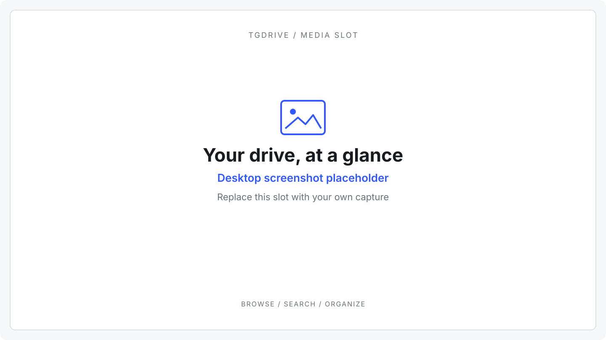
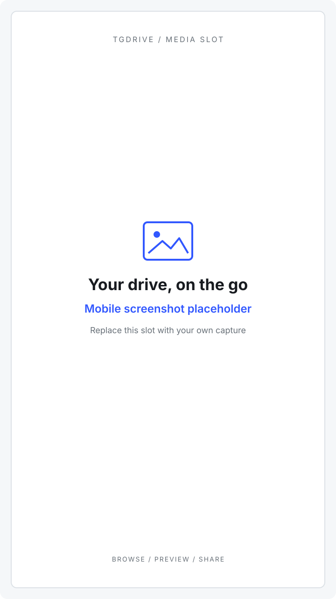
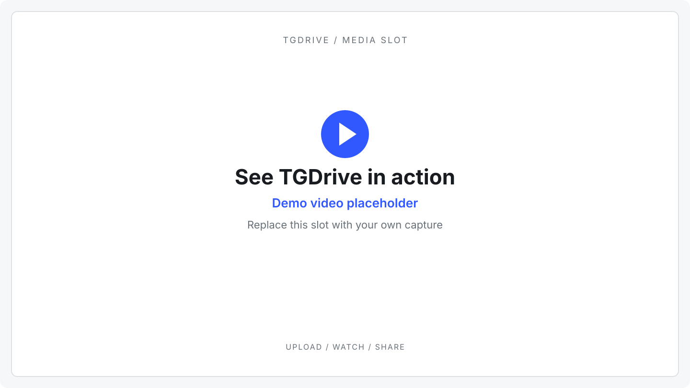
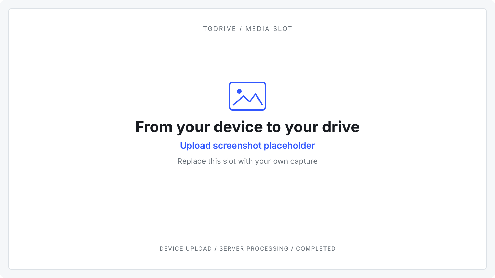

<h1 align="center">
  <picture>
    <source media="(prefers-color-scheme: dark)" srcset="website/public/static/brand/tgdrive-logo-dark.svg">
    
  </picture>
</h1>

  <strong>Your personal cloud. Unlimited storage. Big files welcome.</strong>

Keep your media and files in one place. Upload whole folders,
stream and read in your browser, and share a file or an entire folder with a link.

TGDrive is a free, open-source cloud drive you run on your laptop or server.
It stores your files in a private channel on Telegram.

[Live demo](https://tgdrive.nexgenbots.us/) · [Set up your drive](docs/setup.md) ·
[See it in action](#see-it-in-action) · [User guide](docs/usage.md) · [Documentation](docs/README.md)

<!-- MEDIA: drive-overview. Replace this SVG with a real desktop screenshot. See docs/assets/README.md. -->

## Go big with your files

- **Bring your big files.** Upload once; TGDrive handles splitting behind the scenes and keeps one file for downloads and video seeking.
- **Press play. Start reading.** Stream video and preview photos, PDFs, text, ebooks and comics right in your browser.
- **Share on your terms.** Send a file or an entire folder with links you can expire or revoke.
- **Import direct file links.** [Adaptive parallel retrieval and slow queued imports](docs/usage.md#import-from-a-url), with progress while source checks run.
- **Pick up where you left off.** Resumable uploads, folder uploads, URL imports and bot uploads, plus search, stars and Trash.
- **Give your files a safety net.** Encrypted database backups and optional copies in an independent channel.

## Try the public demo

**[Open the live demo](https://tgdrive.nexgenbots.us/)** · Password: `password12345`

Browse, upload sample files, preview media, organize folders and test sharing.
Configuration and Management stay visible, with changes locked.
Browse the protected **Demo Files** collection, then use **My Files** for your own
test uploads and changes.

It is a shared test drive: visitors can change or delete files outside Demo Files. Use only
disposable, non-private content. [What to try →](docs/usage.md#try-the-public-demo)

## See it in action

| Watch and read | Your drive on mobile |
| :---: | :---: |
|  |  |

<!-- MEDIA: media-preview and mobile-drive. Replace with real viewer and phone captures; update paths and alt text. -->

Demo video · upload, watch and share

<!-- MEDIA: demo-video. Replace this preview with a real uploaded video URL or a linked poster. See docs/assets/README.md#demo-video. -->

*Demo video slot: browse your drive, upload a folder, preview a file and share it.*

Extra screenshots · uploads and transfers

<!-- MEDIA: upload-progress. Replace with a real Transfers capture. -->

## Make it yours

Run TGDrive on your laptop when you need it, or host it on a server for access
and sharing while you are away.

### Why host on a server?

- **Keep your drive online 24/7.** Access, stream and share while your laptop is off, as long as the server stays running.
- **Let transfers finish while you are away.** URL imports, accepted uploads and manual preloads continue without an open browser.
- **Upload through Telegram anytime.** Your configured bot stays available without keeping your computer on.
- **Keep background work moving.** Scheduled database backups, optional backup-channel copies and queued file processing run on the server.
- **Give transfers more headroom.** Better server connectivity and resources can improve upload/download speeds and support more concurrent visitors and transfers.

[Explore server benefits and background work →](docs/setup.md#why-host-on-a-server)

### Choose your hosting

| Option | Starting price | What you get |
| --- | --- | --- |
| **Self-host** | Free TGDrive software | Run on your own computer or server; manage deployment yourself. |
| **Server only** | **₹150/month** | Server hosting; deploy and manage TGDrive yourself. |
| **Managed TGDrive** | **₹200/month** | Server hosting, TGDrive deployment and ongoing management included. |

**To buy either option, contact [TechShreyash on Telegram](https://t.me/TechShreyash).**
[BoltCloud](https://boltcloud.net/) is a pricing/server-options reference only;
if it is unavailable, ask directly for current prices and availability.

For deployment management on your own server, [Coolify](docs/setup.md#coolify)
is recommended and free to self-host. [Compare hosting options →](docs/setup.md#hosting-beyond-your-machine)

All TGDrive features are available when self-hosting and on every managed plan.
There are no extra plan-based caps on file size or file count. Higher plans add
server resources for more concurrent visitors, uploads and downloads.

**Your drive stays yours, even when hosting expires.** Completed files remain in
your Telegram channel. Keep your MongoDB catalog, Telegram access and recovery kit
to reopen the same drive on your laptop or another server without re-uploading
completed files. [Keep your drive when a plan ends →](docs/operations.md#when-a-hosting-plan-expires)

[**Set up TGDrive →**](docs/setup.md) · [Explore the user guide](docs/usage.md)

Storage, backups and limits

TGDrive is a single-owner, internet-connected drive. The server needs disk for
unfinished uploads and caching. Keep its Telegram channel private and app-managed,
preserve persistent volumes, and save recovery keys separately.

Keep originals until uploads say **Completed**. Once **You can close this tab**
appears, server processing can continue while TGDrive stays running. Shared
links also need a reachable running app.

Unlimited means TGDrive does not meter total stored bytes. Uploads default to
16 GiB and are configurable. Its catalog supports up to 250,000 files/folders;
per-file limits and available staging space still apply.
Telegram access and availability are still required. MongoDB holds the catalog
and settings.

Database backups cannot recover deleted Telegram files. Keep independent copies
of important originals. See [Backup & recovery](docs/backup-recovery.md).

Configuration and contributing

[Configuration](docs/configuration.md) · [Operations](docs/operations.md) ·
[Architecture](docs/architecture.md) · [Development](docs/development.md) ·
[Roadmap](docs/roadmap.md)

Bug reports should include the release, deployment mode and reproduction steps.
Remove credentials and private links. Read [contributor guidance](AGENTS.md);
maintainers can use [release verification](docs/release.md).

To fill the prepared image and video slots, see [Screenshots and demos](docs/assets/README.md).

[MIT License](LICENSE)
