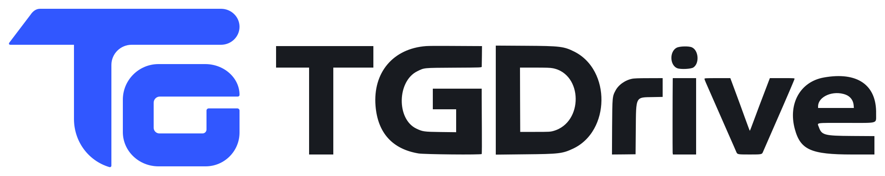
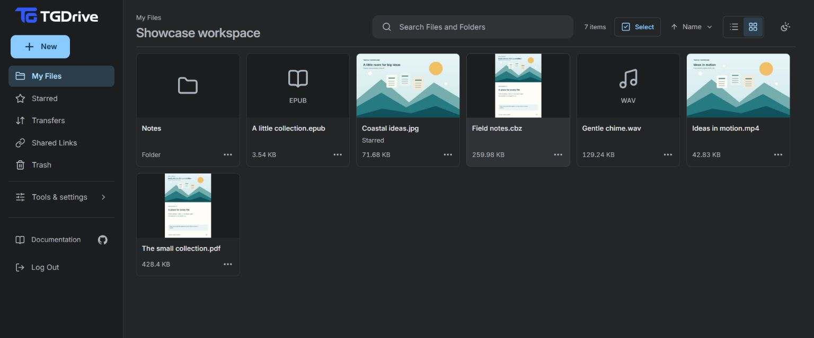
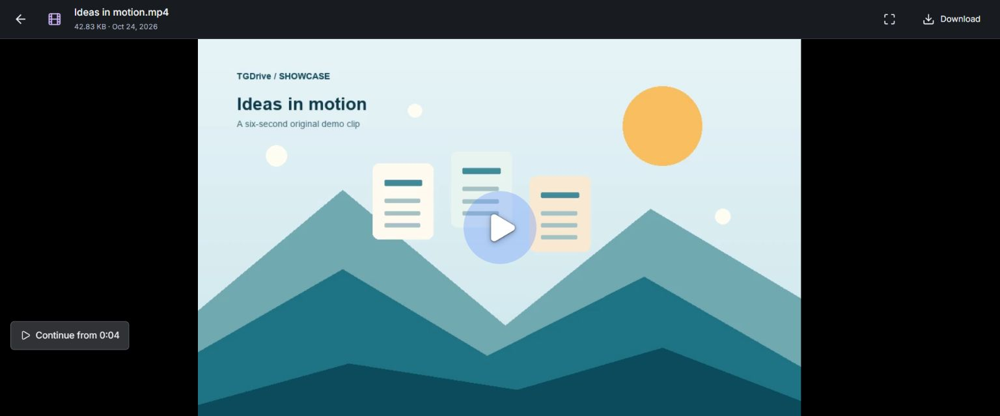
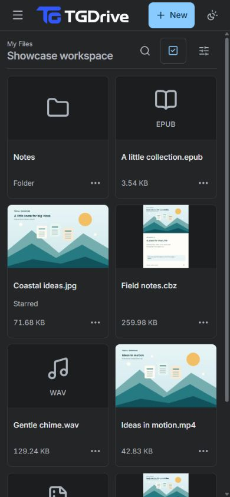

<picture>
  <source media="(prefers-color-scheme: dark)" srcset="website/public/static/brand/tgdrive-logo-dark.svg">
  
</picture>

**Your Telegram files, organized like a cloud drive.**

[**Try the demo**](#try-the-demo) · [**Set up TGDrive**](docs/setup.md) · [**Screenshots**](docs/showcase.md) · [**Docs**](docs/README.md)

TGDrive is a self-hosted web app that turns a private Telegram channel into a
file drive. You run it on your computer or a server, then upload, browse, stream
and share files from your browser. Files are stored in your channel, and
TGDrive keeps the folders, previews and sharing on top.

## Features

| Feature | What you can do |
| --- | --- |
| **[Upload and resume](docs/usage.md#upload-files-or-folders)** | Upload files or whole folders. Interrupted uploads resume when you reselect the originals, and large files split automatically. |
| **[Import from anywhere](docs/usage.md#import-a-torrent-or-magnet-link)** | Bring in torrents and magnet links with their folders, [direct URLs](docs/usage.md#import-from-a-url), or files sent to [your Telegram bot](docs/usage.md#upload-through-your-telegram-bot). |
| **[Watch and read](docs/usage.md#open-preview-and-download)** | Stream video and audio and pick up where you left off. Open photos, PDFs, text, EPUB ebooks and CBZ/CBR comics in the browser. |
| **[Archives](docs/usage.md#create-zips-and-extract-archives)** | Create ZIPs, or extract ZIP, 7z, RAR, TAR and compressed files, as background jobs. |
| **[Share and embed](docs/usage.md#share-and-revoke)** | Create read-only links for files or folders with expiry and revocation, or embed a viewer in your website. |
| **[Recover](docs/backup-recovery.md)** | Save an encrypted backup and the original `ENCRYPTION_KEY` off-host. Restore after database loss, or rebuild a lost channel from a confirmed independent copy. |

New uploads are encrypted before they reach Telegram using your deployment's
`ENCRYPTION_KEY`; [legacy files and optional plaintext bot copies differ](docs/reference.md#stored-file-encryption).
There is no fixed storage quota; file-size limits, server resources and Telegram
availability still apply. [Learn the essentials →](docs/new-user-guide.md)

## Try the demo

**[Open the live demo](https://tgdrive.nexgenbots.us/)** · Password: `password12345`

> [!WARNING]
> The demo is shared with other visitors, who can change or delete unprotected
> files. Upload only non-private samples. [Demo guide](docs/usage.md#try-the-public-demo)

## See it in action

[Watch the 62-second feature tour](docs/assets/current-features.mp4): torrent
imports, ZIP jobs, extraction, video Continue, player settings and the recovery form.

| Video player | Phone layout |
| :---: | :---: |
|  |  |

Captured on 28 October 2026, before the 2.3 interface redesign. The phone view is emulated and the tour's recovery
screen is an obsolete local demo, not current recovery instructions. [Full gallery](docs/showcase.md)

## Get started

TGDrive is free and open source with every feature included. You need:

- Docker with Compose 2.24 or newer
- A Telegram account, a bot and a private channel
- A MongoDB database (the MongoDB Atlas free tier works)

| Where to run it | Guide |
| --- | --- |
| Your computer, while it's on | [Local setup](docs/setup.md) |
| A server, always available | [Server deployment](docs/setup.md#hosting-beyond-your-machine) · [Hosting choices](docs/hosting.md) |

> [!IMPORTANT]
> Keep TGDrive running for website access, share links and background work.
> Keep separate copies of important files: TGDrive does not guarantee
> permanent storage. [Backup basics](docs/backup-recovery.md)

## Documentation

| I want to… | Read |
| --- | --- |
| Learn how TGDrive works | [TGDrive basics](docs/new-user-guide.md) |
| Upload, organize, preview and share | [User guide](docs/usage.md) |
| Back up or recover a drive | [Backup and recovery](docs/backup-recovery.md) |
| Change settings or fix a problem | [Configuration](docs/configuration.md) · [Operations](docs/operations.md) |
| Build on TGDrive or contribute | [Docs home](docs/README.md) · [API reference](docs/api.md) |

## Community

- **News:** [updates channel](https://t.me/TechZBots)
- **Help:** [support group](https://t.me/TechZBots_Support) for setup and self-hosting questions
- **Bugs and ideas:** [GitHub issues](https://github.com/TechShreyash/TGDrive/issues/new/choose)
- **Security:** report privately as described in [SECURITY.md](SECURITY.md)
- **Contributing:** see [CONTRIBUTING.md](CONTRIBUTING.md)

TGDrive is released under the [MIT License](LICENSE).
