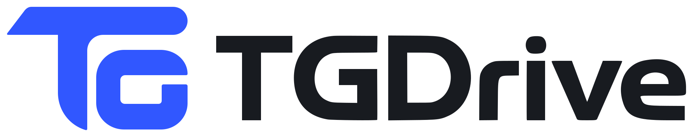
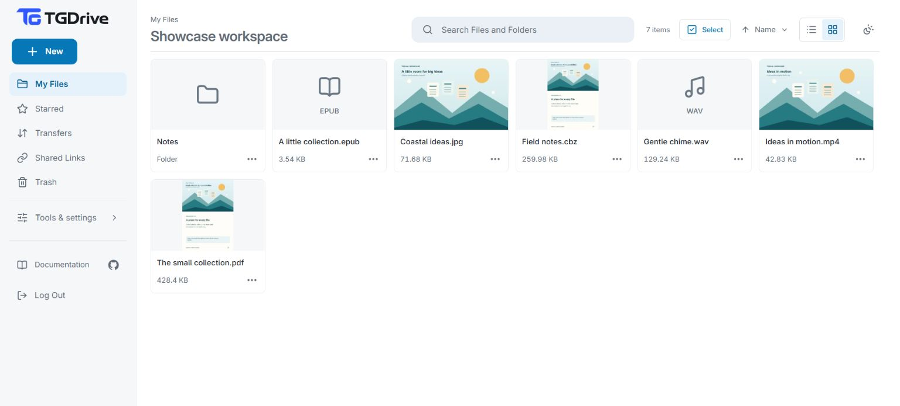
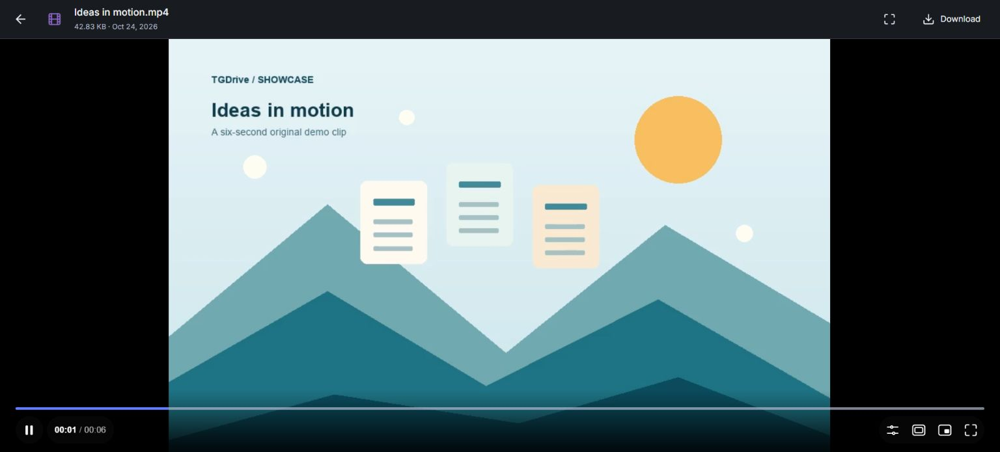
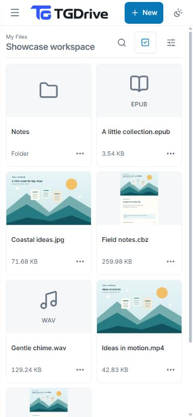

<h1 align="center">
  <picture>
    <source media="(prefers-color-scheme: dark)" srcset="website/public/static/brand/tgdrive-logo-dark.svg">
    
  </picture>
</h1>

  <strong>Turn Telegram into your personal cloud drive.</strong>

TGDrive brings the convenience of Google Drive to
[Telegram's free unlimited cloud storage](https://telegram.org/faq_premium#q-is-telegram-still-free).
Run it on your own computer or server to store files in a private Telegram
channel, organize folders, stream videos and read documents in your browser.
Upload large files without splitting them yourself, and share files or folders
through links you can set to expire or revoke.

**[Try the demo](#try-the-public-demo)** · **[Set up TGDrive](docs/setup.md)** · **[Explore screenshots and videos](docs/showcase.md)**

> [!IMPORTANT]
> **Must read before using TGDrive: [New-user guide and FAQs](docs/new-user-guide.md).**
> Essential for everyone using or running TGDrive, including managed hosting:
> storage limits, upload status, privacy and backups.

## Features

- **No fixed total storage limit.** TGDrive does not cap the total space your files use in Telegram.
- **Upload files larger than 2 GB without manual splitting.** TGDrive splits the upload into smaller parts and presents it as one file for playback and downloading.
- **Resumable file and folder uploads.** Preserve folder structure and resume interrupted device uploads by reselecting the originals. Once TGDrive confirms it has received all files, Telegram uploading can finish with the tab closed while the app runs.
- **Import from URLs or Telegram.** Paste a direct file URL, or send and forward files to your configured Telegram bot, to add them to your drive.
- **Organize and find files.** Create folders, search by name, star favorites, switch between list and grid views, and restore items from Trash.
- **Play videos and audio in your browser.** Stream supported media, with subtitles, audio-track selection and chapters when available.
- **View documents, photos, ebooks and comics.** Open images, PDFs and text, and read EPUB ebooks and CBZ/CBR comics in your browser.
- **Share files and folders with a link.** Give others read-only access, choose an expiry and revoke access when needed.
- **Prepare files for smoother access.** Preload before watching or sharing. While file data stays cached, repeat visits and shared-link viewers can reuse it without downloading it from Telegram again.
- **Follow transfers and server activity.** Track progress, search transfer history, and monitor server resources, traffic, Telegram activity and cache use.
- **Backups and recovery.** Save encrypted backups of your file list, folders and settings, and optionally copy completed files to a separate Telegram channel.

[Explore features and workflows in the user guide →](docs/usage.md)

## Try the public demo

**[Open the live demo](https://tgdrive.nexgenbots.us/)** · **Password:** `password12345`

Try TGDrive in your browser without installing anything. Explore the protected
**Demo Files** collection, or upload disposable samples to **My Files** to try
organizing, previews and sharing. Configuration and Management are visible, with
changes locked.

**The demo is shared.** Other visitors can change or delete files outside
**Demo Files**. Use only disposable, non-private content.
[Demo guide →](docs/usage.md#try-the-public-demo)

## See it in action

| Watch and read | Your drive on mobile |
| :---: | :---: |
|  |  |

[Explore the full screenshot gallery and video walkthroughs →](docs/showcase.md)

Watch the upload and sharing walkthrough

[Open the video](docs/assets/upload-and-share.mp4) · [All walkthroughs](docs/showcase.md)

Silent walkthroughs recorded at normal speed, with a visible cursor overlay,
click highlights and step captions. The mobile image uses an emulated viewport,
not a physical phone. See [capture notes](docs/assets/README.md).

Extra screenshots · uploads and transfers

## Make it yours

Choose where TGDrive runs. The app is free and open source, with all features
included in every setup. You provide your own Telegram channel, bots and MongoDB
database; hosting and database resources may have their own costs.

| Where to run it | Get started |
| --- | --- |
| Your computer | [Local setup](docs/setup.md) for use while your computer is on |
| Your own server | [Server deployment](docs/setup.md#hosting-beyond-your-machine) for a drive you can reach while your laptop is off |
| A server we manage for you | [Optional managed hosting](docs/hosting.md#optional-managed-hosting) for help with setup and maintenance |

### Why host on a server?

A server lets you use your drive from other devices, share links with others and
keep accepted transfers running while your laptop is off. TGDrive, MongoDB and
Telegram must remain available, and recipients must be able to reach the app.
[Compare running on your computer and a server →](docs/hosting.md#local-computer-or-server)

### Prefer help with hosting?

We offer optional **managed TGDrive hosting from ₹100/month, including a
server**. We handle deployment and ongoing maintenance, and provide a personal
HTTPS subdomain. You keep full access to the server and TGDrive, using your own
Telegram channel, bots and MongoDB account.

Explore [managed and server-only hosting](docs/hosting.md) for plans, capacity
and ownership details, or [contact TechShreyash](https://t.me/TechShreyash).

## Find your guide

| What you want to do | Where to go |
| --- | --- |
| Learn the basics and find answers to common questions | [New-user guide and FAQs](docs/new-user-guide.md) (**must read**) |
| Upload, organize, preview and share | [User guide](docs/usage.md) |
| Back up your drive or recover after a failure | [Backup & recovery](docs/backup-recovery.md) |
| Change settings, maintain the app or fix a problem | [Configuration](docs/configuration.md) · [Operations](docs/operations.md) |
| Explore all guides, technical details and contributor resources | [Documentation home](docs/README.md) |

## Updates and support

Follow the [updates channel](https://t.me/TechZBots) for announcements, or join the
[support group](https://t.me/TechZBots_Support) for help and discussion.

## Contribute

Contributions, feedback, bug reports and feature requests are always welcome.
[Open an issue](https://github.com/TechShreyash/TGDrive/issues) or start with the
[development guide](docs/development.md) and [contributor guidance](AGENTS.md).
Include your release and reproduction steps in bug reports; remove credentials
and private links.

[MIT License](LICENSE)
