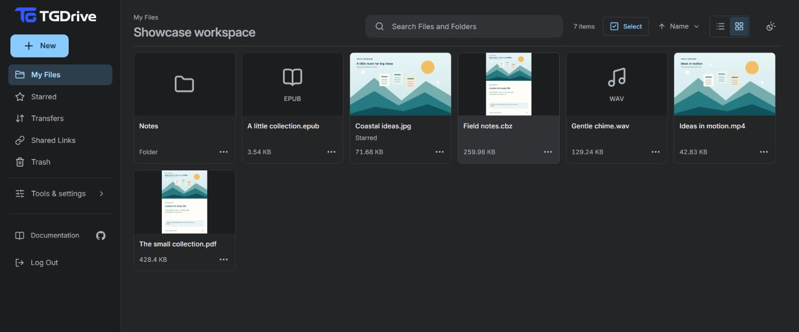
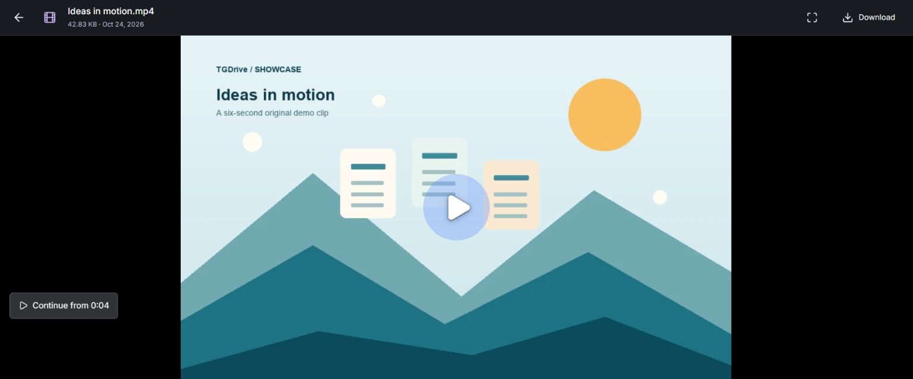
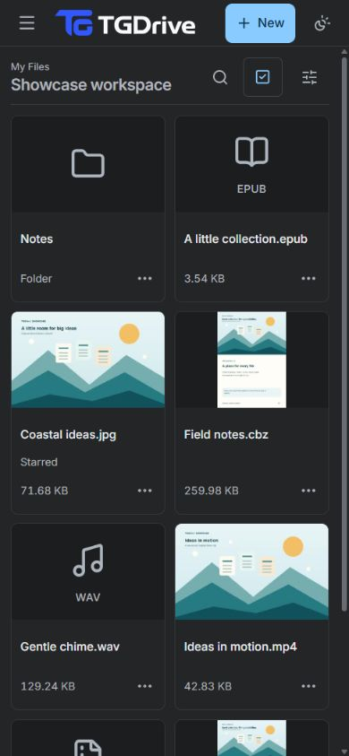

# TGDrive

**Your Telegram files, organized like a cloud drive.**
Run TGDrive on your computer or server to upload files and folders, stream media,
read documents and share links from your browser. Files live in your private
Telegram channel; TGDrive adds the file browser and handles large-file splitting.

**[Try the demo](#try-the-public-demo)** · **[Set up TGDrive](docs/setup.md)** · **[Explore screenshots and videos](docs/showcase.md)**

## Features

- **[Upload and resume](docs/usage.md#upload-files-or-folders).** Upload files or folders, keep their structure and resume interrupted device uploads by reselecting the originals. Large files split automatically.
- **[Import torrents and magnet links](docs/usage.md#import-a-torrent-or-magnet-link).** Bring in whole torrent folders with their nested structure. Direct file URLs and your configured Telegram upload bot are supported too.
- **[Create ZIPs and extract archives](docs/usage.md#create-zips-and-extract-archives).** Bundle files/folders into a ZIP, or unpack ZIP, 7z, RAR, TAR and compressed files. Follow background jobs in Transfers.
- **[Watch where you left off](docs/usage.md#open-preview-and-download).** Stream supported video and audio. For videos, choose **Continue** from a position saved in this browser; use track/subtitle menus, chapters and seek previews when available.
- **Read and browse.** Open photos, PDFs, text, EPUB ebooks and CBZ/CBR comics. Search, star favorites, manage folders and restore from Trash.
- **Share and embed.** Create read-only file or folder links with expiry and revocation, or embed a viewer in your website.
- **Prepare and monitor.** Preload files for later access; follow transfers, history and server activity.
- **[One file for recovery](docs/backup-recovery.md).** Save an encrypted recovery file and its separate key. Restore the database using surviving Telegram files, or rebuild a lost channel from an optional independent copy.

TGDrive has no fixed total-storage quota. File-size limits, server resources and
Telegram availability still apply. [Learn the essentials →](docs/new-user-guide.md)

## Try the public demo

**[Open the live demo](https://tgdrive.nexgenbots.us/)** · **Password:** `password12345`

Explore **Demo Files**, or upload a disposable sample to **My Files**.
**The demo is shared:** other visitors can change or delete unprotected files.
Use only non-private samples. [Demo guide →](docs/usage.md#try-the-public-demo)

## See it in action

**[Watch the 62-second feature tour](docs/assets/current-features.mp4)** — torrent
imports, ZIP jobs, extraction, video Continue, player settings and the recovery form.

| Watch the tour | Your drive on mobile |
| :---: | :---: |
|  |  |

Captured **28 October 2026**. The silent tour uses edited cuts; its recovery
screen is a local demo. The phone viewport is emulated.
[Gallery and video chapters](docs/showcase.md) · [Capture notes](docs/assets/README.md)

## Make it yours

TGDrive is free and open source, with every feature included. You provide a
Telegram channel, bot and MongoDB database. Hosting and database resources may
have their own costs.

| Where to run it | Get started |
| --- | --- |
| Your computer | [Local setup](docs/setup.md) for use while your computer is on |
| Your own server | [Server deployment](docs/setup.md#hosting-beyond-your-machine) for access while your laptop is off |
| Help with setup and maintenance | [Optional managed hosting](docs/hosting.md#optional-managed-hosting), including a server and HTTPS address |

Keep TGDrive running for website access, share links and background work.
Keep separate copies of important files: TGDrive does not add end-to-end
encryption or guarantee permanent storage. [Privacy and backup basics](docs/new-user-guide.md).

## Find your guide

| What you want to do | Where to go |
| --- | --- |
| Understand how your drive works | [TGDrive basics](docs/new-user-guide.md) |
| Upload, organize, preview and share | [User guide](docs/usage.md) |
| Back up your drive or recover after a failure | [Backup & recovery](docs/backup-recovery.md) |
| Change settings, maintain the app or fix a problem | [Configuration](docs/configuration.md) · [Operations](docs/operations.md) |
| Find technical details or contributor resources | [Documentation home](docs/README.md) |

## Updates and support

Follow the [updates channel](https://t.me/TechZBots) for announcements, or join the
[support group](https://t.me/TechZBots_Support) for help and discussion.

## Contribute

[Report a bug or request a feature](https://github.com/TechShreyash/TGDrive/issues),
or use the [development guide](docs/development.md) and [contributor guidance](AGENTS.md).
Include your version and reproduction steps; remove credentials and private links.

[MIT License](LICENSE)
