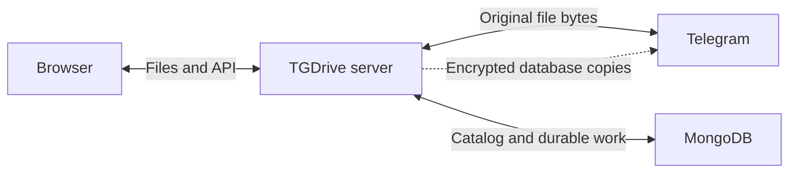

# How TGDrive works

[Docs home](README.md) · [API reference](reference.md#http-api) · [Performance](performance.md)

Where files live, when work becomes durable, and how one drive stays consistent.

[Data and identity](#authoritative-data-and-identity) · [Transfers](#transfer-pipeline) · [Recovery](#database-safety-copies-and-security)

## The short version

**Telegram holds file bytes; MongoDB holds the catalog, settings and durable work.**
TGDrive also sends encrypted database copies to Telegram in the background.

Run **one installation and one FastAPI worker per drive**. Background work runs
inside that process without Redis or a separate task broker. Accepted server
jobs continue without the browser while TGDrive stays running.

## Components

Code map

Backend filenames are under `tgdrive/`.

| Area | Main files |
| --- | --- |
| Web interface | `website/src/` |
| HTTP/authentication | `app.py`, `api_v1.py`, `http_guard.py` |
| MongoDB and read cache | `mongo.py`, `mongo_store.py` |
| Upload receipts and jobs | `uploads.py`, `tasks.py`, `transfers.py` |
| Split files and logical ranges | `multipart_transfer.py`, `multipart_streaming.py`, `logical_media.py` |
| Telegram connections/admission | `telegram_clients.py`, `client_pool.py` |
| Downloads and previews | `streaming.py`, `ranges.py`, `previews.py` |
| Shared cache and preparation | `media_reader.py`, `media_cache.py`, `media_policy.py`, `preloading.py` |
| URL imports | `remote.py`, `remote_ranges.py`, `remote_scheduler.py` |
| Database backups | `mongo_backup.py` |
| Connection settings/Premium login | `management.py`, `managed_settings.py`, `premium_login.py` |
| Lifecycle/setup | `runtime.py`, `__main__.py`, `setup.py`, `scripts/setup.py` |

## Authoritative data and identity

**MongoDB is the source of truth**, including on laptops. The in-memory catalog
is an immutable read cache. Durable collections hold nodes and ordered parts,
shares, operation IDs, jobs and receipts, deletion intents, private settings and
sessions, backup records and the runtime ownership lease.

- Paths use stable item IDs: moves and renames retain identity.
- Names are Unicode-normalized with case-insensitive sibling uniqueness.
- Files reference one Telegram document or ordered parts with offsets, sizes
  and checksums. Public listings hide those locations.
- Schema version 4 tracks revision/commit generation. Catalog bounds are
  128 levels and 250,000 items.

### How a write becomes visible

1. Change an isolated working copy.
2. In a MongoDB transaction, check ownership and generation, then commit with
   majority acknowledgement. Unique indexes enforce active sibling names.
3. Publish the new read cache.

Failure preserves the earlier visible state. Uncertain acknowledgement reloads
MongoDB authority before further work.

## Lifecycle

| Event | Behavior |
| --- | --- |
| Startup | Validate configuration, acquire ownership, load the existing catalog, start clients/jobs |
| Missing catalog | Stop; never silently replace it with an empty drive |
| Lost ownership | Stop admitting writes; repair and restart safely |
| Shutdown | Persist interrupted work, stop tasks, release resources/ownership |
| Reinstall | Reuse the same MongoDB database and deployment identity |

The cloud lease renews in the background and is checked inside writes.
Recovery of unfinished uploads still requires their local staged bytes.

## Account identity and selection

Uploads default to **one slot per bot** (**1–4** allowed); Premium clients keep
one each. FIFO admission selects least-active eligible clients, preferring ready
Premium slots with bot fallback. Uploads/reads share account media/request budgets,
channel pacing and persisted FloodWait deadlines. Demand precedes queued preloads
without preempting running work.
See [performance controls](performance.md#upload-pipeline-and-smaller-splits).

Identity, live limits and account failures

- Slots scale with connected accounts, independently of local I/O. Lower limits
  drain existing leases; higher limits wake eligible waiters.
- Upload preferences load from MongoDB before recovery and enter full backups.
- New documents use at most **2000 MiB**, including Premium; split preference
  `0` uses that same cap. Smaller preferences reduce part size.
- Initial lookup may prefer healthy Premium users. Independent payload windows
  bind the same immutable media through eligible accounts.
- Stable account IDs survive bot-token reordering. A dispatched part retains its
  sender and request ID on retry; undispatched parts may change sender.
- Credential/channel failures quarantine the account and wake waiters. Reads try
  eligible accounts; dispatched uploads keep durable identities and report repair
  errors. Verified channel repair can re-enable live clients; new credentials need
  restart.

### Names and Refresh

Credential checks, cached names and retries

Startup fills missing names from authenticated accounts. **Connections → Refresh**
checks saved credentials/channel permissions through temporary sessions without
test messages. At most two checks run at once; repeated clicks share work. Transient
failures allow three attempts, respecting persisted waits. Cached names survive
failure; probes remain separate from socket health. Settings changes/shutdown
cancel obsolete checks.

## Connection management

Temporary clients verify the owner's revision-guarded candidate accounts/channel
permissions before an atomic private-settings save. New mutations pause until
restart. Editing needs settled jobs/receipts and valid ownership, without requiring
a Telegram database backup.

Secrets are write-only; omitted replacements keep saved values. Premium login uses
owner-bound five-minute in-memory challenges. Codes/passwords are not stored;
sessions enter private settings, never the browser. Cancelled, expired or unsaved
authorizations are revoked.

## Demo access boundaries

Demo mode keeps one shared drive with two session capabilities. The usual
password grants visitor access; an optional separate demo administrator password
grants full access. Its session signature uses a separate credential-bound key,
so clients cannot promote a visitor cookie and credential rotation revokes the
corresponding access. Deployment-only demo administrator credentials are
excluded from saved bootstrap settings. See [authentication](reference.md#owner-authentication).

At startup, demo mode creates a catalog folder with reserved identity
`tgdrive-demo-files`. A request-scoped write policy reaches worker threads and
background jobs. SQLite and MongoDB check its current ancestry within each write
transaction, including ancestor operations that would remove or move protected
content. Upload and job controls also preflight destinations before work starts.
Durable jobs retain the visitor policy and restore it on resume while demo mode
is enabled. Full-access retries can explicitly replace that policy. This keeps
accepted work subject to the same sample protection after the browser closes
or TGDrive restarts.

The UI reads effective session permissions with uncached configuration, waits
for them before enabling management, and clears them when a session ends.
Protected changes return a dedicated error that opens a read-only popup.
Visitor steps and deployment limits live in [public demo mode](configuration.md#public-demo-mode).

## Transfer pipeline

Browser receiving and Telegram dispatch run independently. Each completed receipt
creates a durable job without waiting for its batch. Device receives start at two
files and adapt between one and four; staging, disk headroom and the 1,000
unfinished-receipt bound gate admission.

Device slots rotate between eligible batches. A new receipt reuses the creation
response; existing receipts fetch their confirmed offset and checksums before
resuming. After the last chunk is acknowledged, the device slot admits another
file while a separate lane runs at most two completion requests. This overlaps
payload reception with verification and durable job handoff without unbounded
completion requests. Files retain their local source and tab-close protection
until the server confirms a job identity.

MongoDB receipt creation reserves staging on the event loop before a worker
synchronizes the new file and commits its receipt. Other admissions see that
reservation while persistence is pending, preventing competing admissions from
overbooking storage. Disconnects drain that worker; an uncertain
database acknowledgement retains the file and reservation until reconciliation
or expiry. Other job lifecycle commits and database/network latency can still
delay requests.

Display follows a browser-wide device-first boundary: while any local upload
still needs receipt, pending upload groups show device metrics or **Received**
for accepted files, with Telegram metrics hidden. Once all remaining local files
are server-owned, their Telegram metrics appear together. Telegram jobs run
throughout; this presentation boundary does not delay dispatch.

Batch ETA uses fresh per-file rates, falling back to a rolling measurement of the
batch's current-stage byte counter. File handoffs do not discard that measurement;
it expires after 15 seconds without byte progress. A stage switch, changed batch
membership/total or regressing counter resets its baseline. Restored snapshots
alone supply no observed rate. A byte-complete file publishing alongside other
uploads does not suppress their estimate. Blocking retries/errors and unmeasured
final confirmation/publication are excluded from byte-based ETA claims.

### From a browser to one drive file

1. Receive fixed-size chunks into local staging.
2. Flush bytes, then commit the offset/checksum receipt in MongoDB.
3. Verify chunks and create or reuse one durable job.
4. Send one Telegram document or ordered parts.
5. Publish the logical file once using its stable operation ID.
6. Confirm the database state, report completion and release staging.

A lost response resumes at the acknowledged offset; reselected files must match
saved checksums, not just names and sizes. Fully received files finish verification
and enqueue after a completion-request disconnect; polling recovers their job ID.

| Signal | Guarantee |
| --- | --- |
| Full device progress | Bytes sent; handoff may still be pending |
| **You can close this tab** | All remaining uploads have accepted server jobs |
| **Completed** | Safe point for deleting local originals |

Database backups exclude unfinished staged bytes.

Receipt code: [uploads.py](../tgdrive/uploads.py). Browser handoff:
[transfers.ts](../website/src/transfers.ts),
[deviceUploadStatus.ts](../website/src/deviceUploadStatus.ts).

### Adaptive device upload concurrency

The browser measures aggregate payload throughput independently of Telegram slots.
Freed slots admit eligible files immediately; reductions let active files finish.

Controller thresholds

| Policy | Value |
| --- | --- |
| Start/range/reset after queue drains | 2 / 1–4 / 2 files |
| Sample | 4-second HTTP PATCH payload windows; confirmed-byte fallback |
| Eligible window | Ready backlog; payload occupies ≥70% of receive slots |
| Probe | After 2 stable windows (within 25% of baseline), add one file |
| Keep increase | Next 2 eligible windows gain ≥10% aggregate throughput |
| Degradation | Reduce after 2 nonzero windows below 65% of baseline |
| Stall | Reduce after 15 seconds without previously observed payload progress |
| Pressure | Network errors or HTTP 408/429/500/502/503/504 before handoff |
| Settle before another probe | 30 seconds after pressure/failed probe; 12 after success |
| Discard measurements | Hidden/paused, sample gaps or windows >12 seconds |

Waiting for first progress or a sent body's acknowledgement is not a stall.
Hashing, resume offsets and Telegram work are excluded. Authentication,
cancellation, checksum and storage failures do not lower the limit.
See [deviceUploadConcurrency.ts](../website/src/deviceUploadConcurrency.ts).

### Bounds and retries

Admission, retry identities and restart boundaries

- HTTP 429 pauses new device admission globally; 507 defers only that file.
  Both retain source/offset and retry after at least five seconds or the longer
  `Retry-After`. The controller retains at most 2,000 unfinished batch rows.
- Known device receipts retry network failures, HTTP 408/500/502/503/504 and
  `UPLOAD_OFFSET_CHANGED` conflicts up to three times without further confirmed
  byte progress. Delays are 2, 4 and 8 seconds, respecting a longer `Retry-After`.
  Each retry checks the server offset and verifies the original file's confirmed
  prefix; it also reconciles a lost completion response with the existing job.
  Confirmed byte progress or a manual retry resets the retry budget. Other
  conflicts, authentication failures and checksum mismatches need owner action.
  Creation without a returned receipt ID is not replayed automatically.
- Chunk requests time out after 60 seconds without increasing sent bytes or a
  server response. Progress renews that interval, allowing slow transfers to
  continue beyond 60 seconds in total. Resume HEAD and receipt JSON requests
  have 60-second request deadlines. Retry requires the tab and local source;
  closing the tab still requires reselecting the originals later.
- Folder preparation creates an atomic, repeatable tree; its files then succeed
  or fail independently. Listing refreshes are coalesced without losing rows,
  selection, focus, pagination or scroll.
- Multipart workers follow eligible account capacity and check live increases
  each second. Database backups are separately serialized.
- Confirmed remote identities survive retry. Catalog operation lookup reconciles
  a committed file whose job-journal update was interrupted.
- Bounded 512 KiB upload RPCs share request/rate admission with downloads and
  metadata. Provider waits are respected, never bypassed by rotating identities.
- Confirmed documents survive restart. Partial-document RPC acknowledgements can
  survive in-process retry; unfinished payload uploads restart after process exit.
- File finalization does not wait for an encrypted snapshot. Completed catalog
  entries cannot be cancelled as unsent media.

### Cancellation and destination changes

| Situation | Result |
| --- | --- |
| Cancel before/after dispatch | Reclaim local work / reconcile and clean up remote outcome first |
| Destination moved | Follow stable folder ID |
| Receiving destination trashed | Retain acknowledged bytes; restore or cancel |
| Destination gone before commit | Cancel/reconcile unpublished remote work |
| Database persistence fails | Retain staged bytes and remote identities for retry |
| URL retrieval interrupted | May fetch again from byte zero; live byte progress is advisory, while reservations and lifecycle changes are journaled |
| Bot-mode ingestion | Separate path without the browser queue's full durability contract |

URL starts return a job before source I/O. A separate scheduler grants full-speed
source slots and paces bounded waiting connections; validated ranges share an
unpublished staging file. Promotion preserves the sequential prefix. Workers drain
before that file can close or a fallback can truncate it. Source retrieval releases
its slot before Telegram upload. See [URL intake](performance.md#url-import-intake)
for scheduling, representation checks, storage claims and expiry limits.

Permanent deletion journals intent, then atomically removes the subtree/shares
and drops completed-intent message references. **Original Telegram messages remain**,
for every file age and retry. Reconciliation, lineage and independent-backup
barriers still apply; different selected items complete independently.

### Finished history

Resolved jobs stay in a paged history, separate from temporary browser popups.
The Transfers page's **Clear history** removes finished display history;
see [the workflow](usage.md#transfer-history).

Compaction, browser ownership and destination lookup

Resolved upload/import jobs become compact MongoDB summaries; terminal live jobs
can expire. Archives enter full backups, omit private recovery context and cannot
be retried as live jobs. Folder uploads carry one explicit identity through
receipt, job and archive; ordinary files and URL imports retain separate task
identities. Task status and search matching are determined before pagination,
and every member of a selected folder is returned together. Completed children
of a running folder do not become a separate finished task.

The Transfers page shows 20 finished tasks per numbered page. Browser-owned
finished tasks consume page slots before server history; an explicit server
offset fills the remaining slots. Folder exclusions keep a partially received
local folder out of server-only finished counts. Temporary grouping hints recover
remembered older folders without rewriting their archive. Hints are bounded by
request size, 1,000 groups and 2,000 member IDs; older groups without usable hints
remain separate server records.

Exact task totals scan archived summaries in batches on a worker, holding task
summaries and the selected folders' members rather than every archived job.
Numbered reads are O(history size); the legacy indexed cursor API remains
available. Startup does not load the full archive. Dismissing a deletion popup does
not clear history; deletion notices stay separate.

Manual history clearing deletes archived summaries and persists a hidden marker
on terminal live jobs, preserving their recovery contexts, staged-byte ownership
and backup barriers. Hidden jobs stay out of history and are not archived when
pruned. Job polling marks them `history_cleared` so other browsers can reconcile
completion before removing their rows. A job that resumes or is retried becomes
visible again.
Queued/running jobs and members of unfinished folders are excluded. The browser
also excludes folders still receiving device files and removes its finished
receipts only after the server confirms success. Failed requests leave browser
rows available for retry; a partially completed server clear is safe to repeat.

Browser `initiatedHere` markers scope floating panels; global history includes
other browsers. URL imports retain server identity/origin across reloads without
requesting local files. Stable node IDs and the catalog cache resolve destinations.
Show in Folder resolves again, follows moves and rejects trashed/deleted items
before revealing the correct list page.

## Telegram transport and file responses

Telethon with cryptg uses MTProto, distinct from the hosted HTTP Bot API. Requests
authenticate before origin/cache access. Logical ranges cross part boundaries;
complete parts verify checksums, partial reads verify identity/size. Expired
references refresh from stored messages with bounded retries. Disconnect/failure
closes iterators and leases; missing media or failures after headers can interrupt
responses. Successful finite playback ranges retain a logical viewer for up to
5 seconds to bridge to the next request. Abort or expiry stops owned partial
background warming; the existing byte and capacity bounds still apply. Every
new HTTP request reauthorizes and validates metadata before reusing server blocks.

## Media and performance

Uploads retain original document bytes. Text previews read at most 256 KiB;
local PDF.js uses bounded lazy ranges up to 256 MiB; SVG uses a passive image;
video uses the local Movi/WASM player. Unsupported files retain original downloads.
Quality choices exist only for representations actually present in Telegram.

[Performance](performance.md) owns cache budgets, shared fills, adaptive read-ahead,
preload qualification, eviction and diagnostics. Preloads are disposable
acceleration, never catalog commits or backups. Authorization precedes cached
bytes and is rechecked before future shared-stream blocks; revocation cannot
recall bytes already sent.

The player's compressed source buffer grows toward a time goal within a device
memory budget; see the [browser buffer policy](performance.md#browser-playback-buffer).
Growth preserves downloaded bytes. This source budget is not a decoder-memory
cap. The custom
player handles loading/errors, local styles, tracks, chapters and source changes;
its buffered time estimates differ from server cache coverage. Neither extra
bots nor a cache guarantees codec/device playback speed.

## Database safety copies and security

Background backups read consistent durable collections, compress/encrypt with
AES-256-GCM, journal the encrypted source identity, and verify received ciphertext
before confirmation. Restore requires the matching key and an empty database;
it revokes browser sessions. Archives omit original Telegram media and staged
payloads. See [recovery](operations.md#encrypted-telegram-backups),
[independent channel protection](backup-recovery.md) and
[security](reference.md#security-and-privacy).

### Shared-link identity and re-copying

Shares resolve stable item IDs and current scope, so explicit links survive
moves/renames. Owner listings include expired links; access and exposure warnings
use active shares only. Secret rotation prevents reconstructing existing URLs
without revoking them; retain those URLs or explicitly create replacements.

How TGDrive reconstructs an existing share URL

Re-copying derives capabilities from a random share ID and persistent owner
secret with domain-separated HMAC-SHA256, then verifies against the stored hash.

## Diagnostic history

MongoDB retains 31 days of bounded minute aggregates; lifetime traffic checkpoints
are separate. Missing samples remain gaps. Telemetry is disposable, excluded
from encrypted catalog backups, and never required for file operations.
See [reading the Performance page](performance.md#read-the-performance-page).
