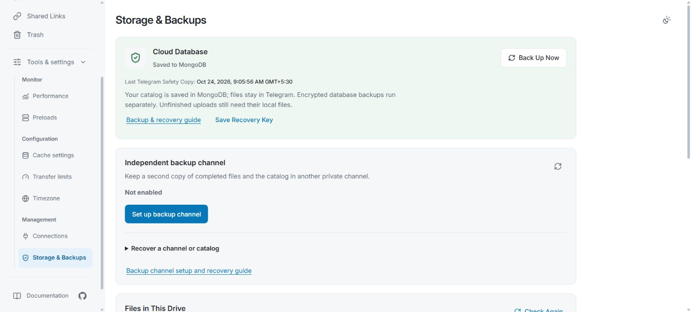

# Backup & recovery

[Docs home](README.md) · [Operations](operations.md)

**Must read before using TGDrive: [New-user guide and FAQs](new-user-guide.md).**
A second channel can help if one copy is lost, but both copies still use
Telegram. Recovery is manual and needs a surviving copy with its matching keys.

> [!IMPORTANT]
> Save matching keys outside the server, wait for a **confirmed restore point**, and test recovery before relying on it. **Never replace an existing drive with an empty database as a repair.**

**Contents**

- [Choose the right MongoDB recovery route](#choose-the-right-mongodb-recovery-route)
- [Set up an independent backup channel](#set-up-an-independent-backup-channel)
  - [Prepare the Telegram accounts and channels](#prepare-the-telegram-accounts-and-channels)
  - [Enable and confirm the first copy](#enable-and-confirm-the-first-copy)
  - [What this copy retains](#what-this-copy-retains)
  - [Rebuild a lost backup from the surviving main channel](#rebuild-a-lost-backup-from-the-surviving-main-channel)
  - [Recover a lost main channel from a surviving channel](#recover-a-lost-main-channel-from-a-surviving-channel)
  - [Recover only the database when the surviving channel is healthy](#recover-only-the-database-when-the-surviving-channel-is-healthy)
  - [Interruptions and reports](#interruptions-and-reports)
- [Keep the MongoDB recovery kit outside the server](#keep-the-mongodb-recovery-kit-outside-the-server)
- [Make and check a MongoDB backup](#make-and-check-a-mongodb-backup)
- [What the encrypted MongoDB archive contains](#what-the-encrypted-mongodb-archive-contains)
  - [Reopen the existing MongoDB drive](#reopen-the-existing-mongodb-drive)
  - [Restore a lost database from Telegram](#restore-a-lost-database-from-telegram)
- [Verify your recovery kit periodically](#verify-your-recovery-kit-periodically)

| Protection | Recovers | Limits |
| --- | --- | --- |
| Encrypted MongoDB archive | Catalog, part mappings, settings and shares | Cannot recreate deleted Telegram file bytes |
| Optional independent channel | Completed documents/parts and matching recovery catalogs | Only confirmed copies; both channels still depend on Telegram |
| Original files saved outside Telegram | Files you can upload again | Check that the copies open correctly |

Large files need every stored part and the catalog that joins them together.
Unfinished uploads also need their staged bytes or original device files;
the backups below do not contain those unfinished bytes.

Find Storage & Backups in the interface

The [administration gallery](showcase.md#connections-and-backups) shows the
website's entry points. These captures do not demonstrate a completed backup or
recovery; follow the confirmation and recovery steps below.

## Choose the right MongoDB recovery route

| Situation | Route |
| --- | --- |
| Restart, update or redeploy | Keep MongoDB, secrets and volumes; no restore or initialization. |
| Server or managed hosting expires | [Keep the drive and move hosts](operations.md#when-a-hosting-plan-expires); preserve the catalog, Telegram access and recovery kit. |
| Machine/app folder lost, MongoDB survives | [Reopen the existing drive](#reopen-the-existing-mongodb-drive). |
| MongoDB lost or deliberate rollback | [Restore a `.tgdb` archive](#restore-a-lost-database-from-telegram) into an empty database. |
| Main Telegram channel lost | [Recover from an independent channel](#recover-a-lost-main-channel-from-a-surviving-channel). |
| Both channels inaccessible, or no matching key | Use surviving MongoDB, another usable backup/key pair or external originals. |

## Set up an independent backup channel

Enable this optional feature under **Tools & settings → Storage & Backups → Independent backup channel**. Normal work continues during synchronization; an upload is not independently protected until its restore point is confirmed.

### Prepare the Telegram accounts and channels

1. Create a private broadcast backup channel and dedicated BotFather bot using a **separate Telegram account**. Keep independent recovery access to it.
2. Give the backup bot administrator access to **both channels**, with **Post Messages**, **Edit Messages** and **Delete Messages**. Use a different bot from every main storage bot; a new token does not change identity.
3. Keep both channels private, auto-delete **Off**, and **Restrict Saving Content** off where it blocks copying. Keep main bots' [standard permissions](setup.md#2-prepare-telegram).
4. Change files through TGDrive. Do not edit/delete referenced documents, alter recovery pins or post unrelated content in these channels.

Prepare accounts and permissions in Telegram. TGDrive checks channel state and bot access, but cannot prove human ownership; the separate-account acknowledgment is your responsibility. Extra bots do not remove rate limits.

### Enable and confirm the first copy

- [ ] Choose **Set up backup channel**; enter its negative numeric ID and backup bot token. Confirm the separate-account preparation, then **Verify and start backup**.
- [ ] Save `tgdrive-channel-recovery-key.json` with **Save recovery key**. Keep it outside Telegram and the server.
- [ ] Let synchronization finish. You can close the tab; the server continues. **Pause** preserves progress; **Resume** continues confirmed work.
- [ ] Wait for **Backup confirmed**, check the revision, and save the key JSON **again**. Its `restore_point` records capsule message IDs in both channels; export again when keeping a newer point.

**100% bytes is not confirmation.** Destination documents and matching encrypted recovery metadata must verify in both channels. Later changes can remain pending.

Copies run sequentially and reuse Telegram document references; original file
bytes are not downloaded and reuploaded through TGDrive. Telegram can still
require a cooldown. Leave TGDrive running until the displayed retry deadline;
new activity entries include the wait duration and the failed operation when
available. A cooldown alone does not call for changing bot permissions.

After confirmation, a healthy unchanged backup gets a routine health check
hourly, rather than starting another file-copy run. The check verifies channel
access, the saved recovery capsule and its pin. Changes to files, folders or
saved settings can need a new recovery snapshot even without another upload;
confirmed document mappings are reused. Browser status refreshes read saved
progress and do not initiate Telegram logins or copies.

Temporary MongoDB connection failures and timeouts show **Waiting to retry** and
retry automatically after 30 seconds while the server runs, including when no
files have changed. Confirmed restore points, matching keys and pending copy
identities are retained. Database permissions, invalid configuration or lost
ownership require repair; restore access and restart TGDrive before retrying.
Until backup confirmation succeeds, permanent catalog removal remains blocked.

Retries, restarts and private bot sessions

Retry/Resume verifies already copied documents before confirming a restore point.
Missing or changed parts prevent confirmation. Saved retry deadlines and confirmed
copies survive restart; restarting or choosing Resume does not bypass a Telegram
cooldown. Pause and Disable remain effective if a request finishes or fails later.

The backup bot reuses private session files under `DATA_DIR/sessions`. Preserve
them across restarts and keep them private like bot tokens. Changing the bot
token or API credentials, losing a session or having it revoked can require
authorization again, subject to Telegram's waits. An idle health-check wait
preserves the last confirmed restore point.

See [backup pacing and verification](architecture.md#independent-backup-pacing-and-verification)
for exact timing, batching and deletion-barrier rules.

### What this copy retains

The copy includes completed documents and an AES-256-GCM encrypted `tgdrive-replica.tgdb` capsule: catalogs, remapped part locations, recovery credentials and supported settings/connections. It is separate from a full MongoDB archive; **do not interchange their files or keys**. Document bytes are not separately encrypted by TGDrive.

| Recovery data | Main channel | Independent backup channel |
| --- | --- | --- |
| Encrypted channel recovery capsule | Saved | Saved and pinned |
| Full encrypted MongoDB archive | Current archive created or reused | Same confirmed archive copied and verified before **Backup confirmed** |
| Portable catalog | Included in channel recovery data | Included in the encrypted recovery capsule |

Snapshots cover their confirmed revision. A failed setup does not establish a confirmed copy in the new backup channel. Save the recovery-key JSON outside the server and Telegram after confirmation.

Old documents/capsules remain: this is not a deletion mirror. Older recovery points can restore removed records and revoked shares. Review sharing after recovery. Pausing backup can also hold permanent catalog removal until protection resumes or is explicitly disabled; ordinary browsing, uploads and metadata changes continue. See [deletion behavior](usage.md#why-permanent-deletion-keeps-the-telegram-files).

### Rebuild a lost backup from the surviving main channel

Preserve the working main channel/catalog. Create an empty private backup channel on the independent account and grant the backup bot access to both channels. Choose **Backup settings → Replace backup channel**, verify the new destination, wait for confirmation and save an updated key export. Replacement leaves the old remote channel/capsules intact.

For permission/network trouble, repair access and Retry/Resume the existing operation instead. Disabling automatic backup stops new protection; it does not confirm pending changes or erase existing copies.

### Recover a lost main channel from a surviving channel

**Only files in the selected confirmed restore point can be recovered.** Keep the source, saved key JSON and persistent `DATA_DIR` intact. Recovery pauses file mutations until activation or explicit cancellation.

1. Open **Independent backup channel → Recover a channel or catalog**, or the authenticated **Storage recovery** screen if the catalog cannot open.
2. Enter the surviving channel ID, a backup bot token with access, and the JSON's 64-character **`key` value**, not the whole JSON. Leave the key empty only for a verified plain catalog checkpoint.
3. Leave **Checkpoint message ID** empty to try the latest pinned capsule. If the original main channel's ordinary checkpoint owns the pin, enter `restore_point.source_message_id` from the export. Use `backup_message_id` for that recorded backup-channel point.
4. Choose **Inspect recovery copy** and check its source, revision, files and bytes. Inspection does not activate a drive; a catalog cannot replace missing source documents.
5. Create an **empty private main channel**. Add the surviving backup bot and a separate main storage bot as administrators. Enter its ID/main bot token, repeat the destination ID, then **Copy to new main channel**. The source stays unchanged.
6. Wait for all parts and recovery metadata to verify. Repair errors and resume **the same operation** after reload/restart; preserve its server-side candidate and journal.
7. At **Recovered drive verified**, repeat the channel ID and choose **Activate recovered drive**. Copying alone does not switch drives. Restart the service/container when instructed; browser refresh is insufficient. The former catalog/configuration remain for review.
8. Check representative images, videos, PDFs, split downloads, Starred items, shares and Connections. Restore optional bots/sessions as needed, configure a separate independent backup, confirm it and export the current key/restore point.

### Recover only the database when the surviving channel is healthy

After inspecting a capsule, choose **Restore the database only on this surviving channel**. Supply a main bot distinct from the backup bot and repeat the surviving channel ID.

TGDrive verifies referenced parts/sizes. Activation is still explicit and requires a service restart. The surviving channel becomes main; configure a separate backup afterwards. Use this only when the channel and required documents remain accessible.

### Interruptions and reports

Retry/Resume the **existing operation** after repairing the underlying problem. Preserve `DATA_DIR`, its journal, bootstrap and activation files across redeployments. Never run competing instances, delete that state or change destinations to bypass an error.

Activation requires a complete current-format private record, including the
pre-recovery key baseline. Incomplete or older records are rejected without
changing the drive; preserve them and repeat recovery inspection.

Failure handling, key rotation and local recovery state

| Problem | Action |
| --- | --- |
| FloodWait/network/uncertain send | Observe the retry deadline; resume confirmed work. More bots do not bypass waits. |
| Process stopped/paused | Restart one instance or choose Resume. Later unconfirmed changes remain unprotected. |
| Bot/access/privacy/copying failure | Repair credentials, permissions and private-channel/content settings. |
| Missing document, wrong size, invalid key/capsule | Keep sources; select the correct key/point or another original. Never mark success manually. |
| MongoDB connection failure or timeout | Leave the server running for automatic retry; preserve the journal and keys. |
| Disk failure, database permissions/configuration or lost ownership | Repair storage/access while retaining journal/catalog; restart after restoring database ownership, then retry. |

During bot sign-in, Telegram can redirect a fresh connection to another data center. TGDrive retries authorization once after that handoff, within the 30-second sign-in deadline. If setup still fails, choose **Verify and start backup** again; for an existing backup, Retry/Resume the same operation. Message publication retries remain controlled by the saved operation journal. An unresolved numeric channel ID reports which channel needs its ID or bot access corrected.

**Activity and report → Download report** gives progress and actionable failures without tokens/keys. Names and IDs may still be private; review before sharing. Never share raw private state or keys.

Server logs record the exception class and safe backup error code for failed
operations. Raw provider messages and credentials are not copied into these
diagnostics. An unexpected error stops new backup work until it is investigated;
it does not erase or replace the last confirmed restore point.

The full MongoDB archive's revision can differ from the channel capsule's revision; they are distinct restore points. Keep both keys. In the JSON, `key` and `mongodb_backup_key` match the recorded `restore_point`; `next_backup_key` and `next_mongodb_backup_key` describe the next generation. Preserve the whole export and older pairs. If pending work captured an older MongoDB key, restore that key or verify **Backup settings** again to capture a fresh snapshot.

The local journal commits each confirmed restore point and its matching keys in
one transaction. If publication is interrupted, the export retains the prior
complete pair or the new complete pair; it cannot combine generations. Preserve
the journal across restarts and save an updated export after confirmation.

Private `DATA_DIR/replica-bootstrap.json` retains owner recovery credentials/password hash. It does **not** provide offline login: MongoDB must be reachable with valid permissions, or startup may fail. A missing/corrupt catalog with reachable MongoDB can permit owner web recovery.

Staged capsules and previous archives are retained. Monitor disk space; staging stops before the configured free-space reserve. Keep useful points off-server and rehearse recovery to a separate test destination.

## Keep the MongoDB recovery kit outside the server

Keep these private and accessible even if TGDrive, Coolify and MongoDB are down:

- [ ] A confirmed `.tgdb` archive or access to its Telegram channel.
- [ ] Its matching **`tgdrive-recovery-key.env`**, exported via **Storage & Backups → Save Recovery Key**.
- [ ] MongoDB URI/database name, owner login, original deployment secrets/configuration and Telegram administrator access.

The `.env` export contains `MONGODB_BACKUP_KEY=` and a 64-character hexadecimal value. Store it separately from archives: anyone with both can read backed-up credentials/catalog. Your login password cannot decrypt an archive.

Container setup may generate this key in `DATA_DIR/deployment-secrets.json`; it still needs an independent copy. Do not regenerate it during redeployment. After rotation, keep old keys with old archives; the export action saves only the current MongoDB key.

## Make and check a MongoDB backup

1. In **Storage & Backups**, choose **Back Up Now**.
2. Wait for **Last Telegram Safety Copy** confirmation. “Saved to MongoDB” alone is not a Telegram backup.
3. Save the matching key separately; optionally download the confirmed `.tgdb` document for an off-server copy.
4. Rehearse restoration into a separate empty database. Stop production while checking the restored installation; keep one active instance per drive.

Automatic snapshots normally run hourly (`MONGODB_BACKUP_SECONDS`). Failures leave the live database intact; check the displayed error/retry time, posting access, key and temporary disk. See [configuration](reference.md#persistence-and-initialization).

## What the encrypted MongoDB archive contains

| Included | Excluded |
| --- | --- |
| Catalog and ordered Telegram part mappings | Original Telegram file bytes |
| Shares, settings, Telegram/owner credentials | MongoDB URI/name and machine paths |
| Transfer, preparation, deletion and recovery records | Unfinished upload bytes, disposable caches and telemetry counters |

Archive verification and encryption limits

Snapshots are compressed app records, limited to 1 GiB expanded; unrelated MongoDB collections are excluded. AES-256-GCM authenticates the archive. TGDrive downloads the uploaded ciphertext and checks SHA-256 before confirming; restore checks authentication, format and completeness before writing.

The recorded revision comes from the catalog inside the exported snapshot.
Changes committed afterwards belong to a later archive. Failed exports are
removed; cancellation waits for the export worker before removing an archive
that has not entered the pending-backup journal. An uncertain journal commit
retains the ciphertext for reconciliation. Hard stops can still leave local
files behind; this cleanup does not sweep older untracked archives.

Restore validation holds the archive, expanded content and parsed records in
memory. Peak memory can substantially exceed the archive's file size; leave
headroom when restoring a large catalog and rehearse it on the intended host.

This encryption covers database archives, not original Telegram payloads or local upload/cache bytes. A catalog cannot recreate a deleted Telegram part.

### Reopen the existing MongoDB drive

Follow the [reinstall instructions](operations.md#reopen-after-losing-the-local-installation): reuse the existing database and original secrets, preserve volumes, and deploy. Check Connections, files, split downloads and unfinished work. Missing staged bytes still require the original source.

### Restore a lost database from Telegram

Use a confirmed `.tgdb` archive, its matching key and the matching TGDrive
version or source commit. Restore into a **new empty MongoDB database with
transaction support**. Changes after the snapshot will be absent; **older shares
may reappear**. Use a private deployment with demo mode off; archive restore is
disabled in demo mode, including for the demo administrator.

1. Download the confirmed database `.tgdb` archive from your private Telegram
   channel and find its matching 64-character key in the saved recovery-key file.
   This is different from an independent channel recovery capsule/key.
2. Prepare a **new empty MongoDB database with transaction support** and configure
   a deployment using the normal [required environment values](setup.md#3-configure-your-drive).
   Preserve the original channel and credentials. Deploy and sign in; automatic
   first setup needs no terminal command. Do not upload files or change settings
   in this temporary empty drive.
3. Open **Storage & Backups → Recover on a New Installation → Restore database
   archive**. The same form is available on the owner **Storage recovery** screen
   when the catalog is missing. Select the archive, enter its matching key and
   type `RESTORE` to confirm. Keep the browser open until the upload and result
   finish.
4. After success, restart/redeploy the application using Docker or Coolify's
   controls, then sign in again. Restored browser sessions are revoked. Saved
   backup credentials/settings apply after restart, subject to explicit
   deployment overrides; see [reinstalling](operations.md#reopen-after-losing-the-local-installation).
5. Check folders, representative downloads, split files, Connections and
   **restored share permissions**. Keep the old database/archive/key until
   verified, then make a fresh confirmed backup and export its key.

Restore limits and failure handling

The website accepts archives up to 1 GiB and restores only an empty destination
or the untouched catalog created by automatic first setup; it does not merge or
overwrite a used drive. Invalid keys/damaged archives fail before stopping normal
work. The archive is authenticated and the destination checked again inside the
restore transaction. A failure after the service pauses can require a restart;
the website reports that explicitly. Temporary uploaded ciphertext is removed
after the attempt. Local unfinished upload bytes are not in the archive.

## Verify your recovery kit periodically

Use the same version or source commit and a separate empty database to confirm
the archive decrypts, the catalog opens and Telegram files remain readable.
A filename alone is not evidence. Keep unfinished-upload originals until completion.

See [exact archive/API boundaries](reference.md#security-and-privacy) and [operational troubleshooting](operations.md#troubleshooting).
