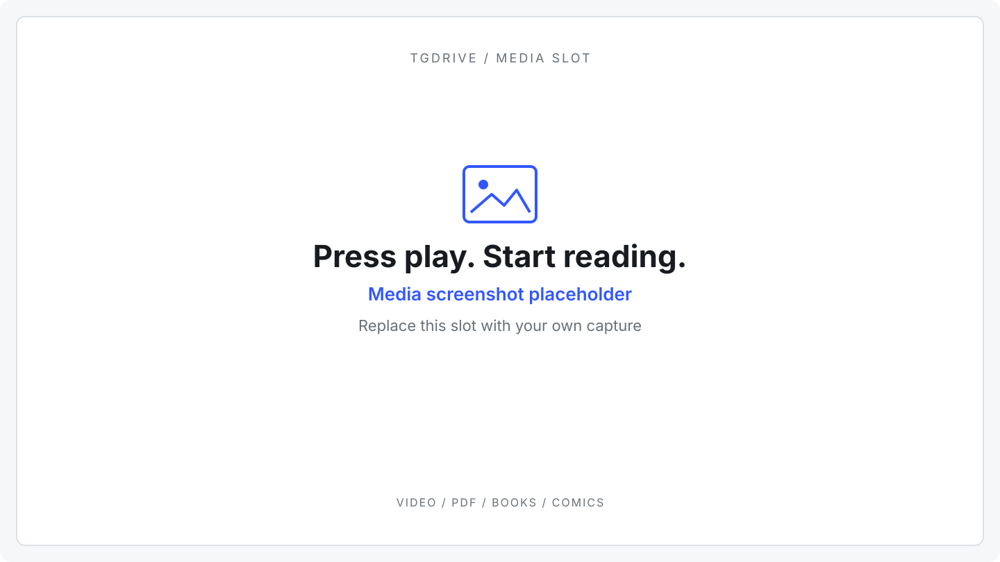

# Reading books and comics

[Docs home](README.md) · [All previews](usage.md#open-preview-and-download)

Open a supported file from **My Files** or a shared folder. **Download** keeps the
original available if previewing fails.

## Choose a format

| Format | Controls | Fetching |
| --- | --- | --- |
| PDF, up to 256 MiB | Scroll, zoom, fit, selectable text | Lazy byte ranges; no cumulative reading cap. |
| EPUB | Chapters, text size/typeface, image-page fit, right-to-left | Metadata, selected chapter and raster images. |
| CBZ / CBR | Pages, fit, right-to-left | Selected image; solid RAR may also need earlier compressed entries. |

EPUB/comics remember your place in this browser for up to 50 books. EPUB text uses
a narrower serif reading column by default; **Reading options** remembers your
text size and serif/sans-serif choice in this browser. Generated resource filenames
appear as readable cover, illustration or section labels. Use
**Reading options** for text size or comic fit/direction, and **Enter Fullscreen**
where supported. Arrow keys navigate while focused; right-to-left mode reverses
them. Escape or browser Back closes the reader.

Image-based manga works in EPUB and CBZ. Image-only EPUB chapters use the page-fit
controls instead of the prose column. Choose **Fit width** for readable panels or
**Fit page** for a whole page, and enable **Right to left** for reversed arrow-key
navigation. The archive/spine order stays unchanged.

Reader screenshot — placeholder

<!-- MEDIA: Replace assets/media-preview.svg with a screenshot of a PDF, EPUB or comic reader with its controls visible. -->

## Bandwidth and compatibility

Readers use the authorized range cache without automatically preloading the whole
book. Small files may fit in one fetched block; solid RAR can require earlier
entries. Byte savings vary.

Pages keep their original image bytes: TGDrive does not upscale, transcode or
recompress them. Some colour pages or spreads are much larger than the average.
The reader shows received bytes after the server has prepared the selected
resource, retries temporary image download failures up to three attempts
(2/4-second waits, or a longer server retry hint up to 30 seconds),
and reports permanent errors without repeatedly requesting them. Leaving the page
cancels that browser's download/retries. EPUB images start loading near the
viewport; offscreen image blobs are released
while placeholders preserve scroll space. Returning to an image revalidates its
private browser cache entry.

The server reuses extracted original pages and parsed chapters/indexes in a
**64 MiB**, 16-result memory cache for up to **five minutes**. Requests for the same
result wait for one extraction. Cache eviction or restart requires parsing again;
source ranges can still be reused from the normal range cache. Browser responses
are private and revalidated, allowing an unchanged authorized page to return 304
without sending its image again. Every request, including cache hits and 304s,
checks current access and source identity. Results are never publicly cached.

PDF, EPUB and comics share the application-themed toolbar and page/chapter
navigation; PDF keeps zoom/text selection and EPUB keeps text preferences. PDF.js
loads shared image resource payloads only when used by a rendered page, instead of
eagerly loading every image in a shared dictionary. Visible pages render before
nearby-page overscan starts. A PDF can still require distant metadata, fonts,
shared masks, or large images before its first page appears; there is no promise
of a fixed number of startup bytes. All PDF rendering happens in the browser,
without server-side page conversion.

EPUB supports passive text, tables and raster images in TGDrive's theme.
Publisher scripts/styles, remote resources, exact fixed layouts, SVG illustrations,
interactive features and DRM/encryption (including encrypted font metadata) are
unsupported. Comics accept PNG/JPEG/GIF/WebP/AVIF when the browser can decode them;
password-protected archives are unsupported.

Reader limits and container dependencies

## Reader limits

EPUB chapters containing images and at most 80 characters of surrounding text
use the illustrated-page layout. More complex publisher layouts can differ.

PDF.js retains a source buffer up to the **256 MiB** file limit. HTTP requests are
split into at most **1 MiB** ranges, with at most **two** reader requests active.
Combined active response buffers normally stay within **64 MiB**. A larger
PDF.js metadata request may run alone, bounded by the accepted source size;
queued requests hold descriptors rather than response buffers. Buffer claims are
released after each success/failure. Reading more than 64 MiB over time does not
close the document. Canvas/page/text budgets still apply; complex PDFs can be
slow or exceed device memory. These are bounds, not a fixed RAM reservation.

| Bound | Limit |
| --- | --- |
| Index/chapter/thumbnail operation | 32 MiB fetched; aligned 1 MiB reads and a four-block parser cache |
| One selected original raster image | 64 MiB encoded image; up to 96 MiB source reads, without loading unrelated ZIP entries |
| Archive | 10,000 entries; 2 MiB ZIP directory; stored/deflate ZIP methods |
| EPUB / entries | 5,000 spine entries; 2 MiB/text entry; 16 MiB thumbnail-source image (independent of the 64 MiB reader page limit) |
| Parser work | Two simultaneous operations, 16 pending requests, 45-second parser timeout; 55-second total route deadline including coalesced waits |
| Linux container parser process | 384 MiB address space, 10 CPU-seconds on every supported host |

Raster image bytes cross the parser boundary as bounded binary output, avoiding
base64 expansion. This does not change the image delivered to the browser. CBR
may need earlier compressed bytes and can exhaust its read budget before a page.
Unsafe/duplicate names and extreme compression ratios fail. Busy readers receive
retry guidance. Budgets apply per operation; cached content may be reused.
Authorization is rechecked during reads. Revocation stops later reads through
that link, while independent links remain valid; delivered bytes cannot be recalled.

## Running the reader

The TGDrive image includes CBR's native libarchive runtime; no host library
installation is needed. If CBR parsing fails, download the original for a
dedicated reader. The bounded parser process is not an OS security sandbox;
keep the deployment image updated.

