# See TGDrive in action

[Docs home](README.md) · [User guide](usage.md) · [Live demo and password](usage.md#try-the-public-demo)

Current screens, captured **28 October 2026**. Start with the short tour, then
open the screenshots for a closer look. Public-demo captures use disposable
samples; monitoring, configuration and recovery screens use a labelled local demo.
[Provenance and coverage](assets/README.md).

## Watch the feature tour

**[Play the 62-second tour](assets/current-features.mp4)** · Silent, with edited cuts.
The tour creates a ZIP, shows torrent/extraction setup, resumes a video and opens
the local recovery form. It does not perform a torrent import, extraction or recovery.

| Time | Feature |
| --- | --- |
| 0:03 | Torrent and magnet import dialog |
| 0:09 | Create ZIP dialog |
| 0:15 | ZIP job running in Transfers |
| 0:21 | Completed ZIP in the drive |
| 0:26 | Archive extraction choices |
| 0:38 | Continue from a saved video position |
| 0:47 | Built-in player settings |
| 0:52 | Local demo: recovery file and key form |

## Import torrents and work with archives

Import magnet links or `.torrent` URLs while keeping nested folders. Create a
ZIP from drive files/folders, or extract ZIP, 7z, RAR, TAR and compressed files.
Accepted archive jobs continue while TGDrive runs, even with the tab closed.
[Torrent guide](usage.md#import-a-torrent-or-magnet-link) · [Archive guide](usage.md#create-zips-and-extract-archives)

| Torrent import setup | Create a ZIP |
| --- | --- |
| 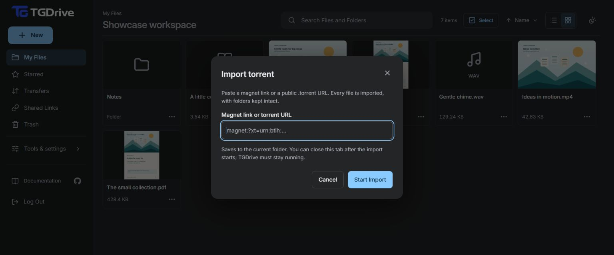 | 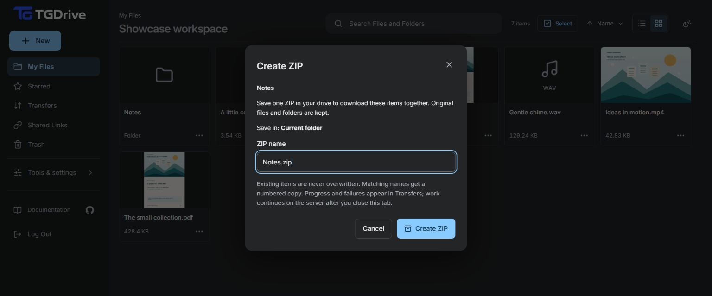 |

Extraction choices and the completed ZIP

The capture session created **Notes.zip** from disposable samples. The extraction
dialog shows destination choices; extraction was not submitted.

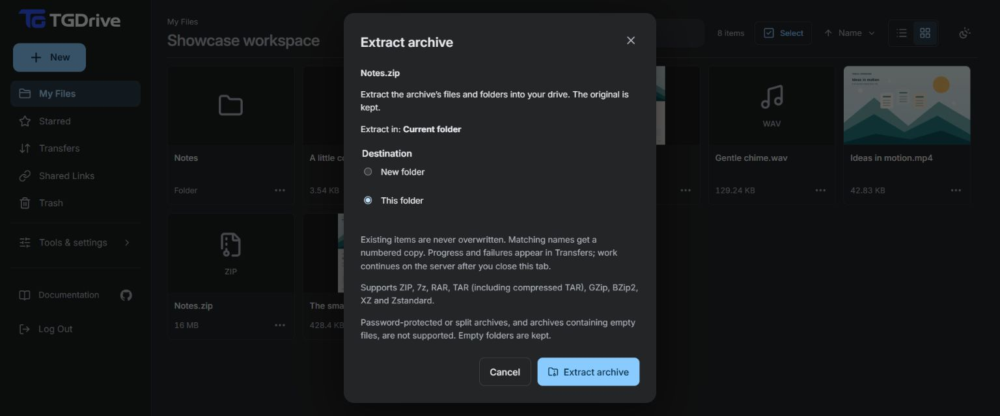

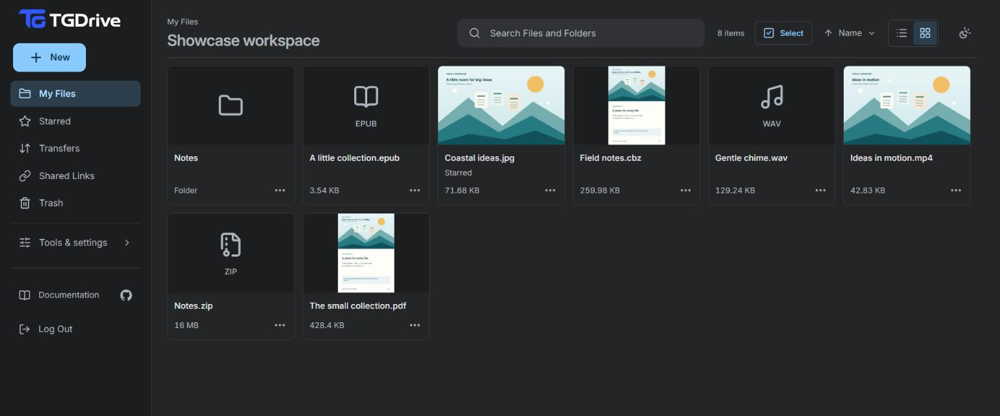

## Read and preview

Videos offer **Continue** from a position saved in this browser. Built-in menus
provide available audio/subtitle tracks and playback settings; chapters and seek
previews depend on the file. PDFs, EPUB and comics have dedicated readers.
[Player controls](usage.md#open-preview-and-download) · [Reader guide](reading.md)

| Continue watching | Current player settings |
| --- | --- |
|  | 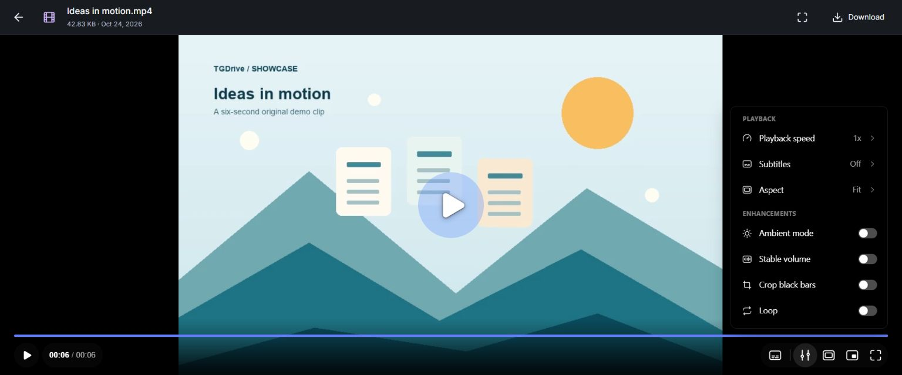 |

Video, image, audio, PDF, EPUB and comic viewers

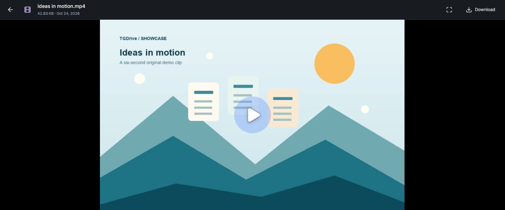

| Image | Audio |
| --- | --- |
| 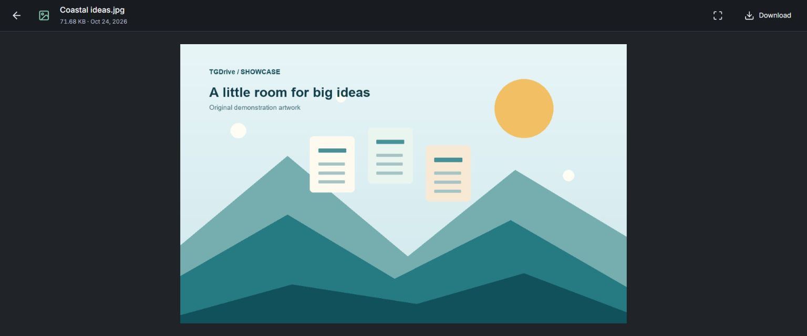 | 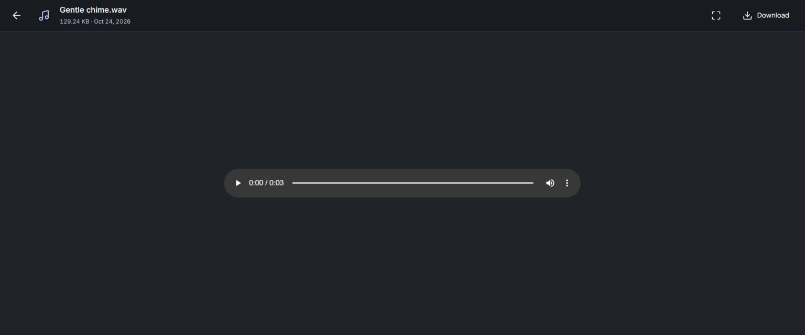 |

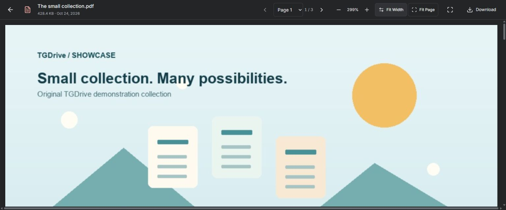

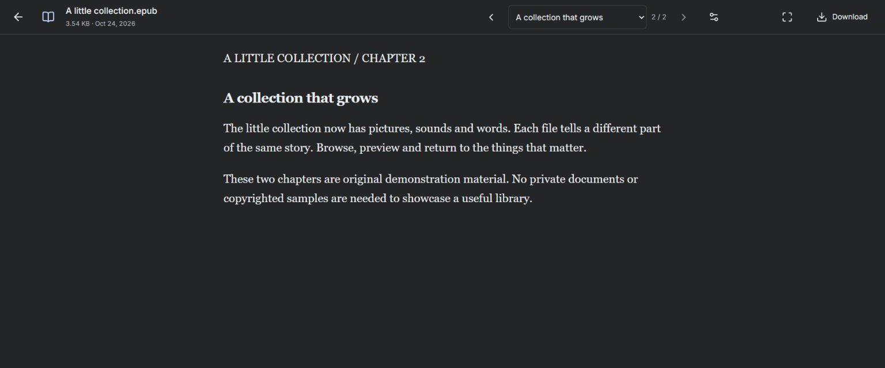

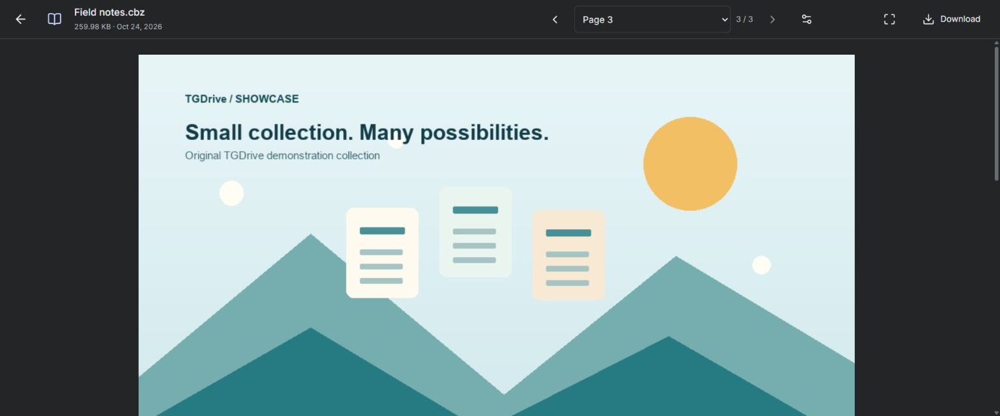

Preview support depends on the file and browser. The original remains downloadable.

## Connections and backups

Save one encrypted recovery file and its separate key. The file restores saved
database data using surviving Telegram files; an optional independent channel
copy supports rebuilding a lost main channel.
[Backup and recovery](backup-recovery.md) · [Connections](usage.md#settings-and-connections)

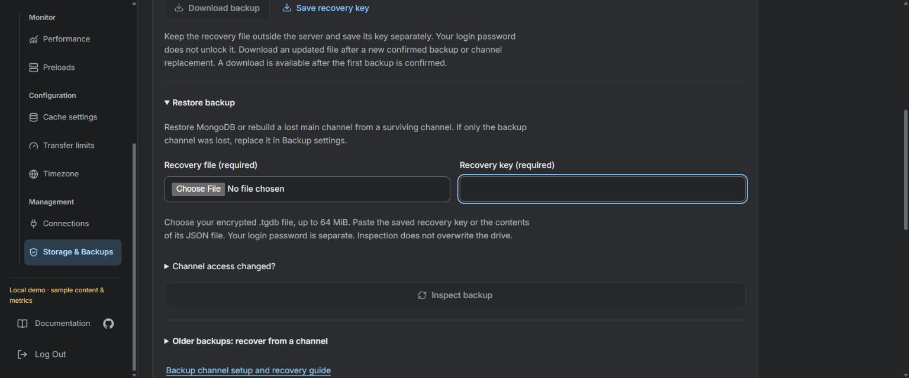

**Local demo:** this screen illustrates the current form. No recovery was started
and no key was exported during capture. Follow the guide to confirm and save your
own backup before relying on it.

## Browse and organize

Use **My Files** for folders, List/Grid views and item actions.
[Browse, search and organize](usage.md#browse-and-organize)

List view, file actions and mobile

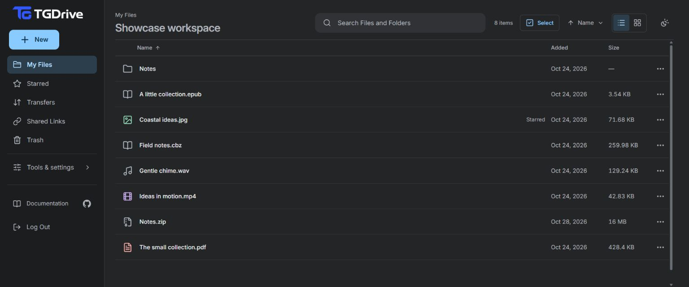

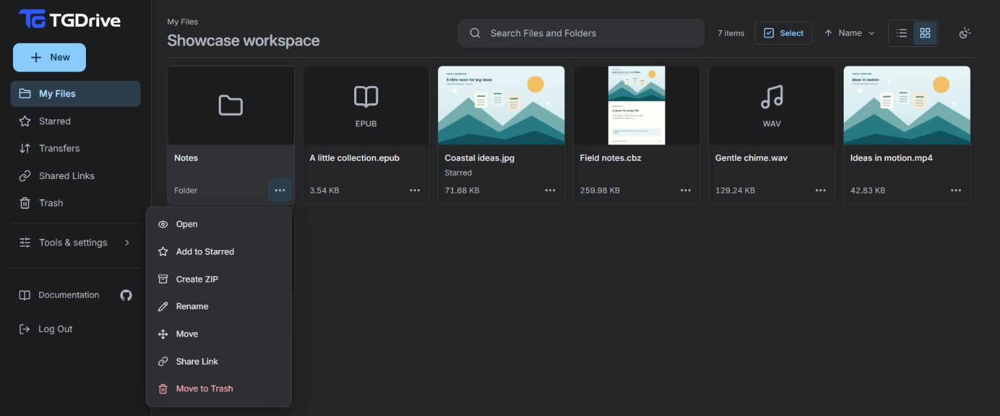

The phone view is an emulated viewport, not a physical-device check.

## Upload and follow transfers

Choose **New → Upload files / Upload folder**, or import a URL. Keep device-upload
tabs open until **You can close this tab** and originals until **Completed**.
[Upload and resume](usage.md#upload-files-or-folders) · [History](usage.md#transfer-history)

Current New menu and URL import dialog

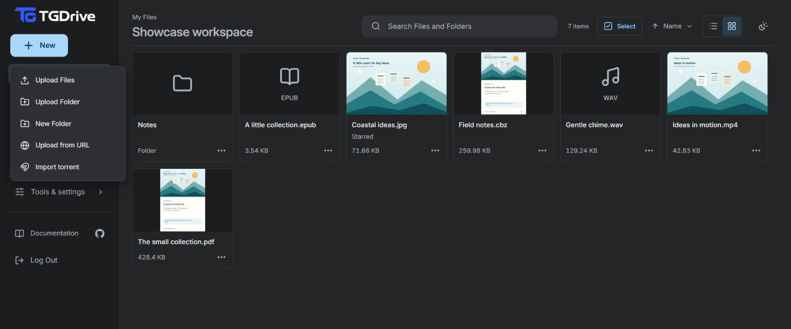

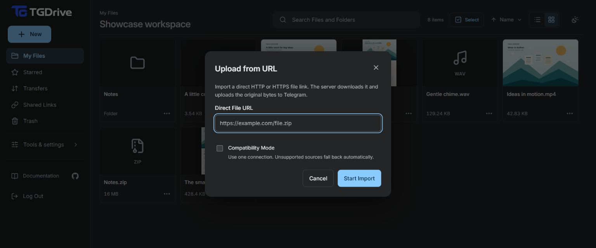

The screenshots show entry points; the tour's running job creates a ZIP.
[URL import guide](usage.md#import-from-a-url)

## Share selected content

Create a read-only link with an optional label and expiry, or embed a file/folder
viewer in a website. Anyone holding a valid link can read its selected content.
[Create, edit and revoke links](usage.md#share-and-revoke) · [Embed guide](usage.md#embed-a-file-or-folder-in-a-website)

## Restore from Trash

**Deleted from** identifies the previous folder. Restore an item, or confirm its
permanent removal from the catalog. Telegram originals remain.
[Trash and permanent deletion](usage.md#trash-and-permanent-deletion)

## Preload and monitor

Choose **Preload file**, then follow **Monitor → Preloads**. Cached data is
disposable and is not a backup. These **local demo screens** show illustrative
metrics, not deployment performance.
[Preload guide](usage.md#preload-a-file-for-smoother-playback-and-downloads) · [Performance guide](performance.md)

Preloads, traffic and server resources — local demo

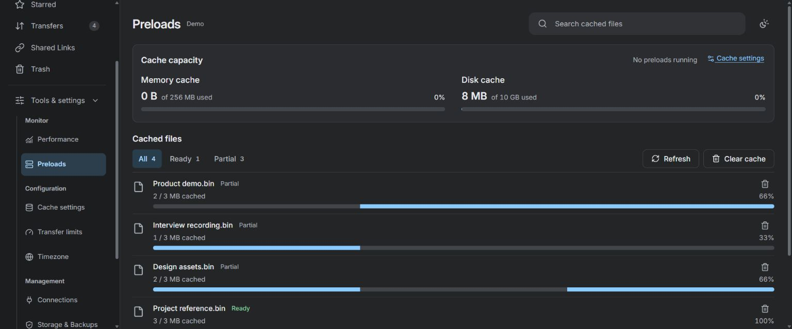

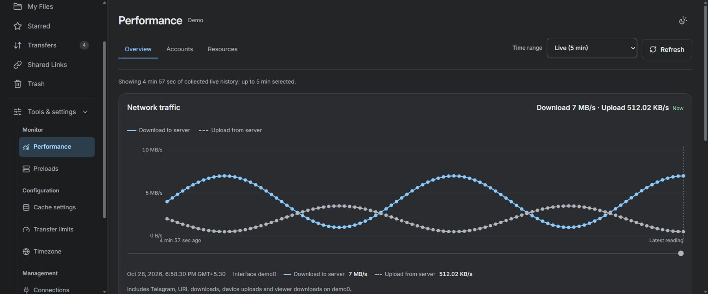

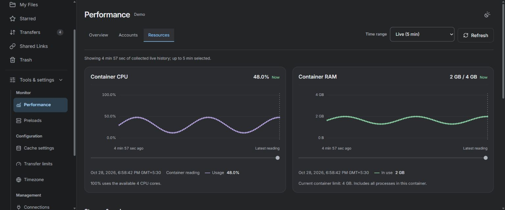

## Configure your drive

Adjust cache, transfer limits and timezone in **Configuration**. Start with the
defaults and save one category at a time. [Settings and defaults](configuration.md)

Cache, transfers and thumbnail rebuild — local demo

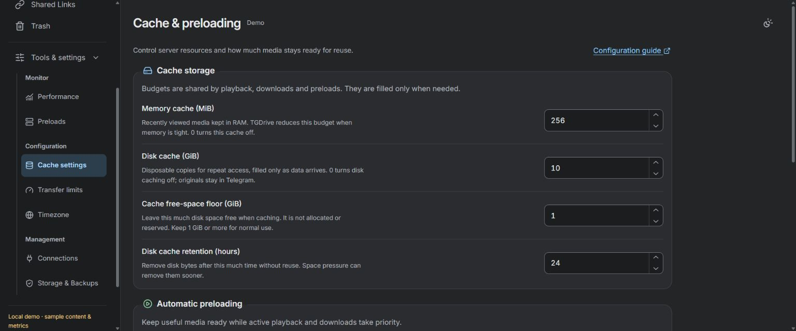

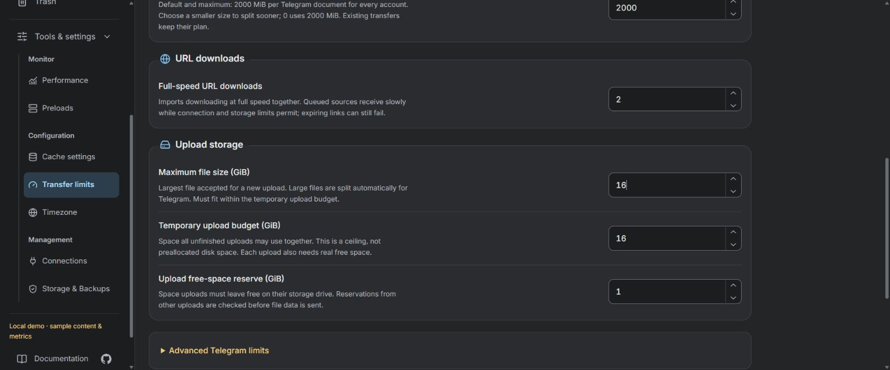

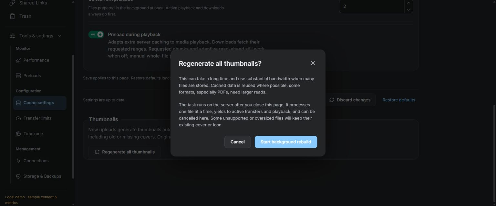

The rebuild was not started. [Rebuild instructions and bandwidth limits](thumbnails.md#rebuild-existing-thumbnails)

## Workflows beyond these recordings

Use the written guides for [sharing](usage.md#share-and-revoke),
[Telegram bot uploads](usage.md#optional-telegram-bot-interface), Premium sign-in,
[multiple devices](usage.md#use-several-devices) and [recovery](backup-recovery.md).
[Setup](setup.md) and [Operations](operations.md) cover installation and moving hosts.
The media illustrates the interface; it does not certify provider throughput,
physical-device compatibility or a recovery rehearsal.
