# See TGDrive in action

[Docs home](README.md) · [User guide](usage.md) · [Live demo and password](usage.md#try-the-public-demo)

Use these screenshots and videos to find a feature, then follow its linked
guide for the full workflow and limits. The captures use disposable sample files
on the live TGDrive website. The silent walkthroughs use continuous 30 fps browser
recordings at normal speed, with a cursor overlay, click highlights and step
captions. Upload and sharing are separate chapters with a title card and brief
end holds. These are demonstrations, not speed measurements. The mobile screenshot uses an
emulated 390 × 844 browser viewport, not a physical phone.

| Watch | Duration | Covers |
| --- | --- | --- |
| [Organize your files](assets/organize-files.mp4) | 3:26 | Views, search, sort, favorites, folder creation, rename and move |
| [Upload and share](assets/upload-and-share.mp4) | 5:20 | Upload progress, history, Show in Folder, share label/expiry, copying and revocation confirmation |
| [Preview and read](assets/readers-and-preview.mp4) | 5:51 | Image/audio/text previews, PDF/EPUB/comic navigation and video playback/settings |

Find a feature in the videos

Times are **minutes:seconds**. Open a video and use the player's timeline to
jump to the step you need.

| Video | Chapters |
| --- | --- |
| Organize your files | **0:09** List view · **0:16** Sorting · **0:31** Search · **0:57** Favorites · **1:31** Create a folder · **2:06** Rename · **2:40** Move |
| Upload and share | **0:14** Upload menu · **0:27** Device file selection · **1:46** Upload starts · **2:00** Transfers · **2:14** Show in Folder · **3:21** Share options · **3:56** Link label · **4:08** Expiry · **4:16** Link management · **4:50** Copy link · **5:14** Revocation confirmation |
| Preview and read | **0:07** Images · **0:25** Audio · **0:47** PDF · **1:25** EPUB · **2:18** Comics · **4:01** Video · **4:31** Player settings · **5:23** Text preview |

The device file picker is outside the browser recording; local paths stay
hidden. Link generation happens between the upload and management chapters.
The management chapter shows copying and the revocation confirmation; the
temporary demonstration link was revoked after recording.

## Browse and organize

Start in **My Files**. Open a folder, switch between **List** and **Grid**, and
choose **Name**, **Date Added** or **File Size** to sort. Open **Select** for
multi-item move or Trash actions. An item's menu also offers rename, star,
sharing, downloading and preloading. [Browse and organize →](usage.md#browse-and-organize)

File actions, search, Starred and mobile navigation

Switch to List for compact rows, or choose a darker appearance from the theme
menu. The same sample collection is shown below in List and Dark Grid views.

| List view | Dark appearance |
| --- | --- |
| 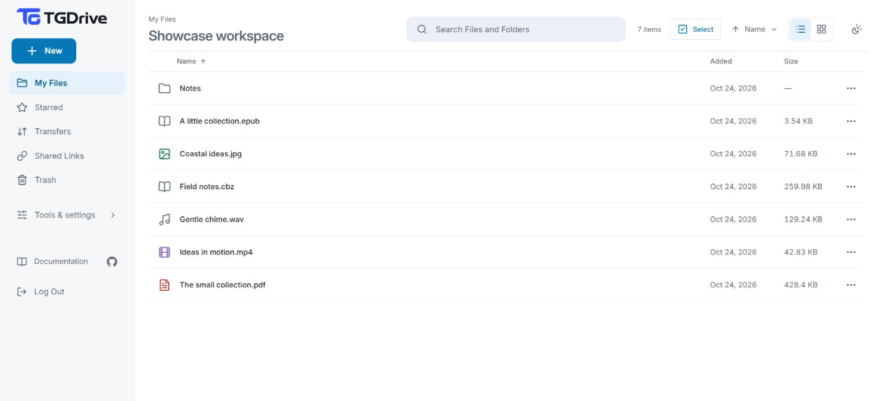 | 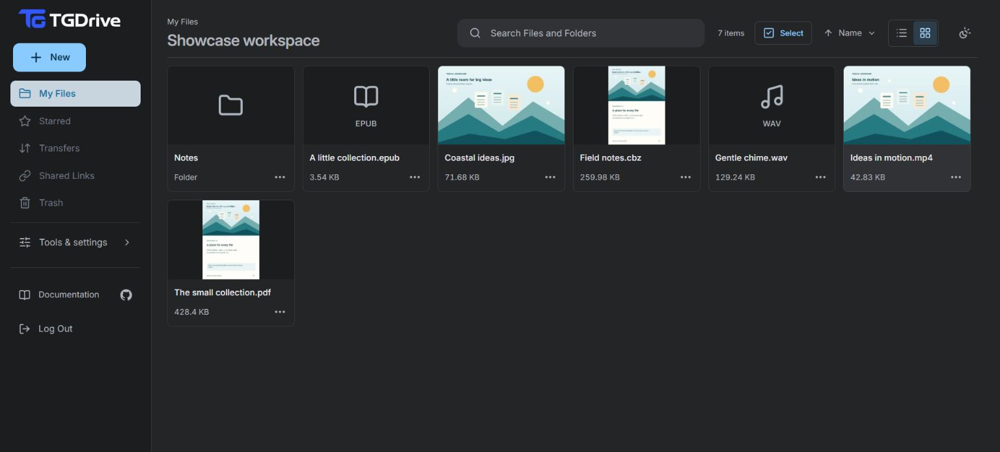 |

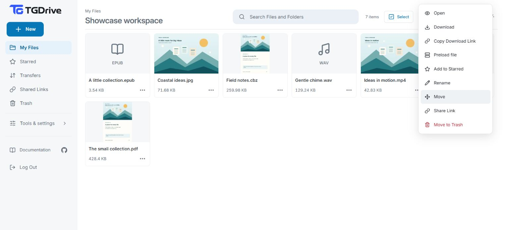

Search finds filenames across your drive and shows their locations. Press **/**
or **Ctrl/Cmd+K** outside an editing field to focus it. Star frequently used
items from their menu, then open **Starred**. Stars follow moves and renames.

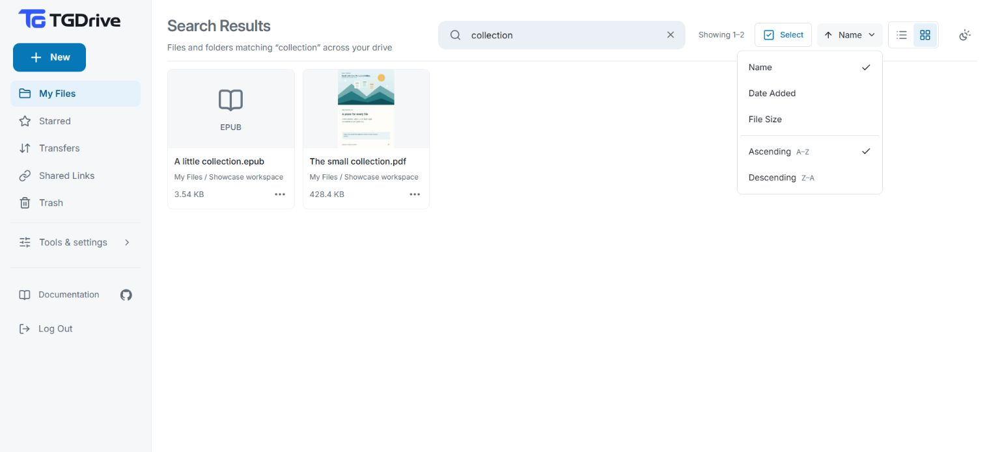

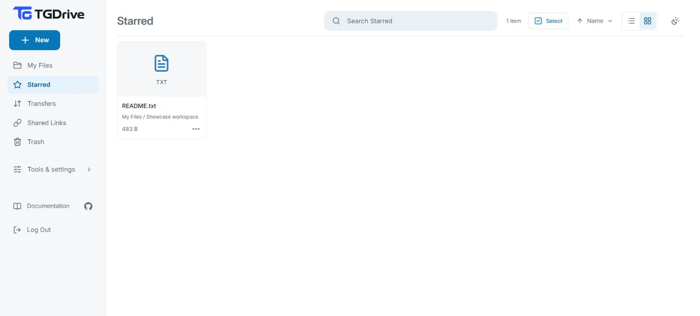

On a narrow screen, tap a file once to open it; use the navigation menu to switch
pages and **View and sort** to adjust the listing.

[Watch file organization](assets/organize-files.mp4).

## Upload and follow transfers

Open the destination, then use **New → Upload files** or **Upload folder**.
Review the folder summary before starting. Follow **Transfers** and keep the
browser open until **You can close this tab** appears. Keep originals until
**Completed**. [Upload instructions and status meanings →](usage.md#upload-files-or-folders)

Folder upload entry point, URL imports and transfer history

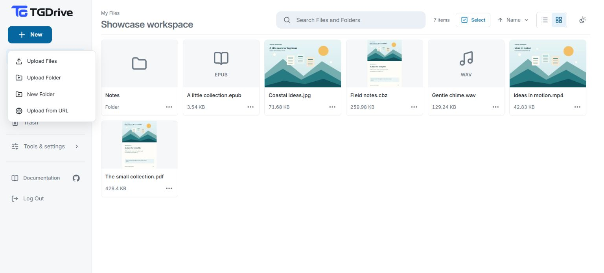

The capture shows where to start a folder upload. Follow the
[written folder-upload steps](usage.md#upload-files-or-folders) for the picker and
confirmation; the recordings demonstrate a single-file upload.

Nested folders stay together in an expandable upload task. Ordinary files and
URL imports have separate tasks. **New → Upload from URL** receives a public
HTTP(S) file on the server; source checks and subsequent stages appear in Transfers.
Accepted URL work can continue with the browser closed while TGDrive runs.

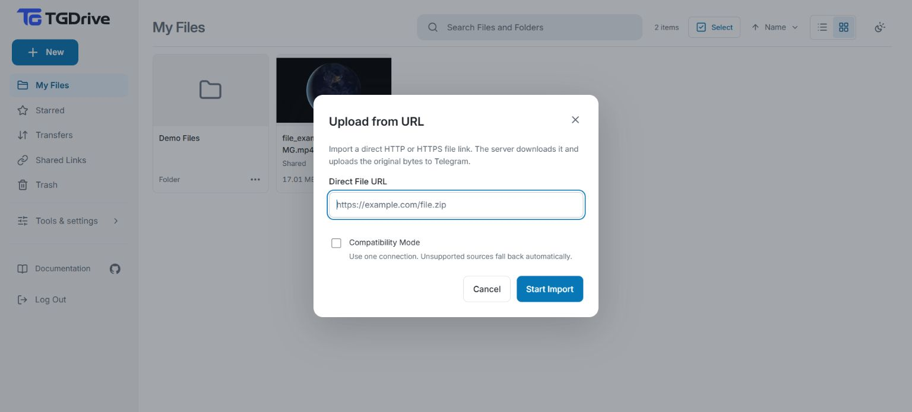

Finished history has **All / Successful / Failed / Cancelled** filters, search
and pages. Use **Show in folder** to locate a completed upload. For interrupted
device uploads, reselect the originals in the existing task to resume from the
confirmed offset. [History →](usage.md#transfer-history) ·
[Retries and resuming →](usage.md#can-i-close-the-tab)

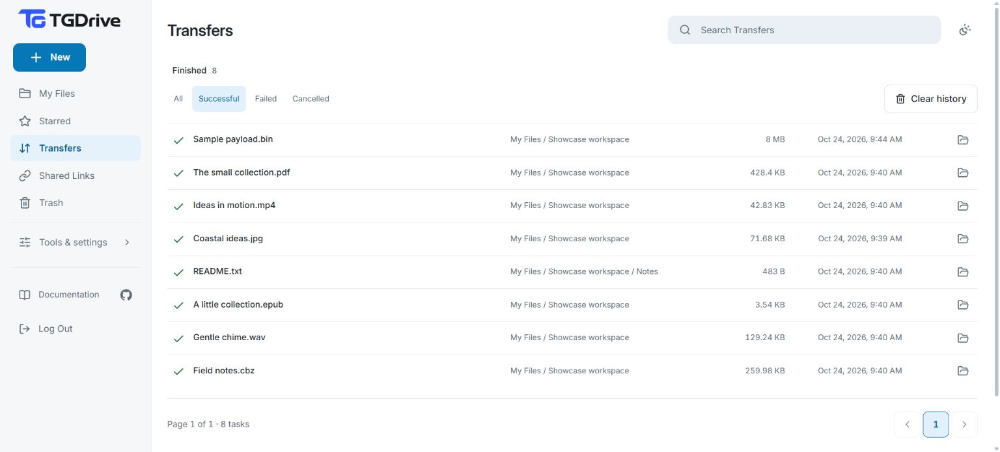

[Watch upload and sharing](assets/upload-and-share.mp4).

## Read and preview

Double-click a file with a mouse or tap it on touch. **Download Original** keeps
the original available; **Escape** or browser **Back** closes the preview.
Preview support depends on the file and browser. [All preview formats and controls →](usage.md#open-preview-and-download)

The player includes seeking, volume and settings. Available audio tracks,
subtitles, chapters and quality choices depend on the source. Use fullscreen
where your browser supports it; touch controls include double-tap seeking.

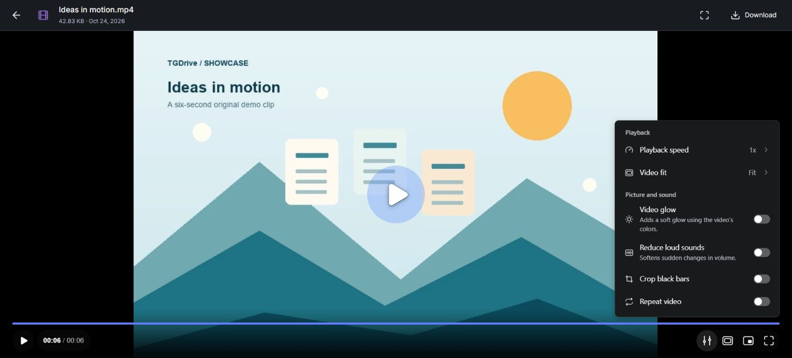

Images, audio and read-only text

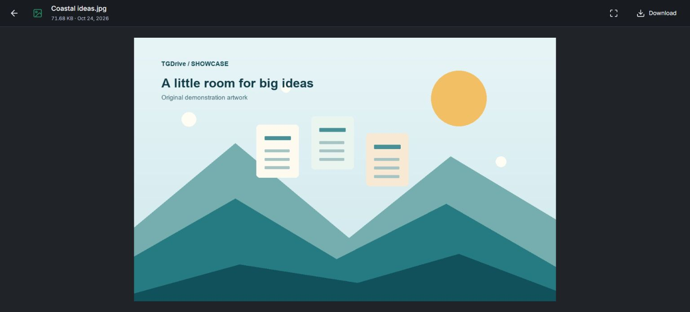

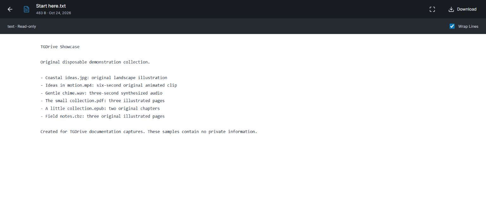

Text previews show the first 256 KiB. Unsupported formats retain their original
download action.

PDF, EPUB and comic readers

PDFs have page navigation, continuous scrolling, zoom, **Fit width**, **Fit page**
and selectable text. EPUB adds chapters and text size/typeface options. Comics
and illustrated EPUB pages offer page fit and right-to-left navigation.
[Reader instructions, remembered position and limits →](reading.md)

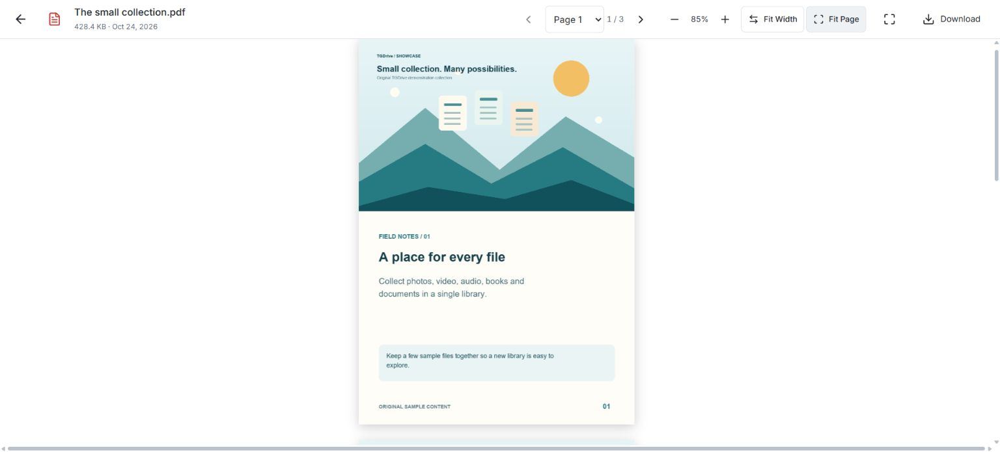

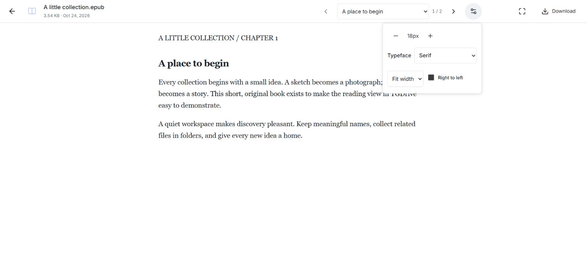

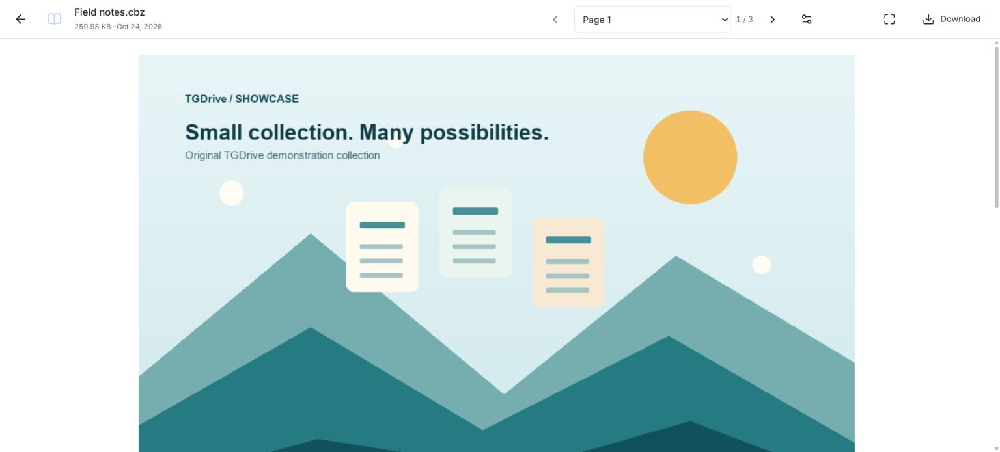

[Watch previews and readers](assets/readers-and-preview.mp4).

## Share selected content

Choose **Share Link** from a file or folder's menu. Add an optional label, select
an expiry and create the link. Anyone holding it can read the shared content;
folder links include accessible descendants. [Create, edit and revoke links →](usage.md#share-and-revoke)

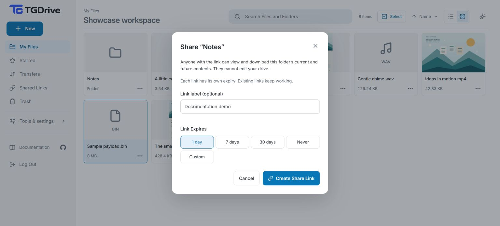

Recipient folder and Shared Links inventory

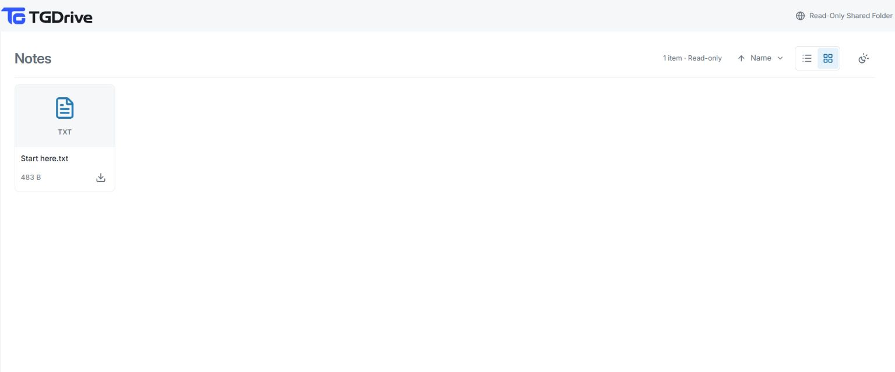

Open **Shared Links** to find each labelled link, change its expiry, copy an
active link or revoke it. Independent links can have different purposes and
expiries. Moving or renaming an item preserves explicit links.

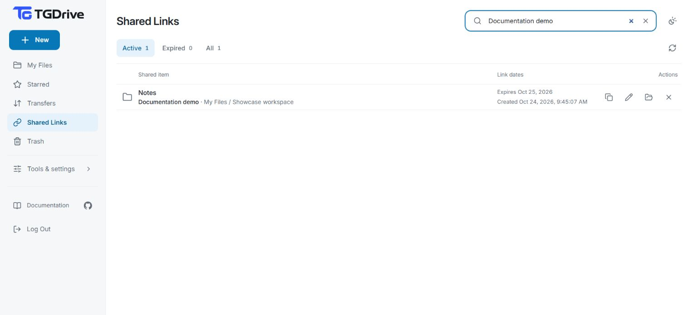

**Copy Download Link** creates or reuses a separate download capability for
download managers. Keep it private and revoke it from Shared Links when finished.
Revocation cannot recall copies already downloaded.

## Restore from Trash

Use an item's **Move to Trash** action, then open **Trash**. **Deleted from**
shows its previous folder; choose **Restore** to return it. Permanent deletion
requires confirmation, removes the catalog records and cannot be undone from
Trash. Telegram originals remain in the storage channel.
[Trash and deletion behavior →](usage.md#trash-and-permanent-deletion)

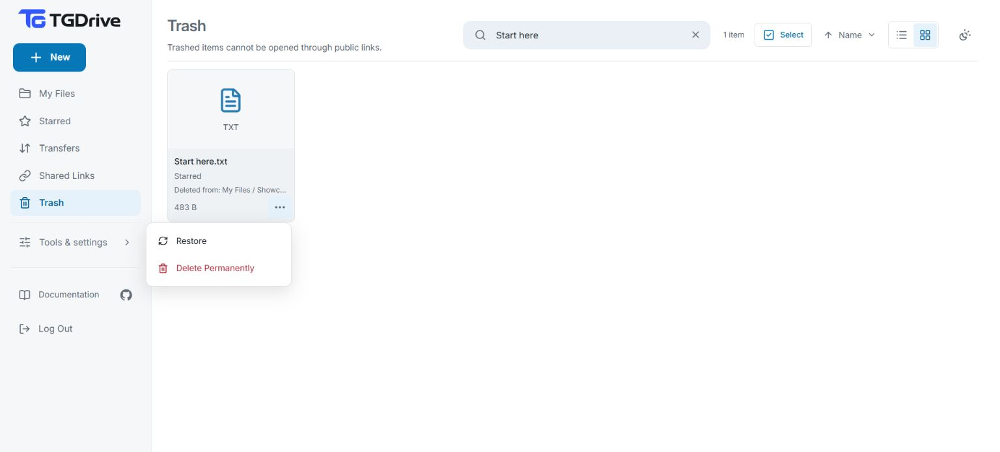

## Preload and monitor

For a movie, large download or busy share, choose **Preload file** from its menu.
Open **Monitor → Preloads** to follow the queue and inspect server cache coverage.
Preloading can continue with the browser closed while the server runs. Cache is
disposable and is not a backup. [Preload instructions →](usage.md#preload-a-file-for-smoother-playback-and-downloads)

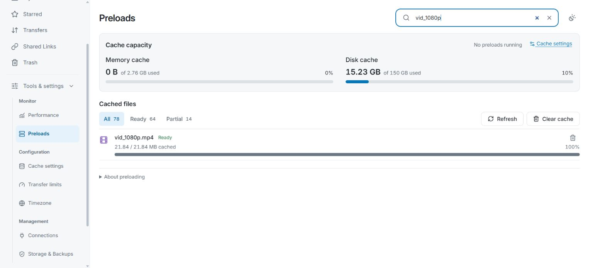

Performance overview and server resources

Open **Monitor → Performance**. **Overview** shows network traffic and live
transfers; **Accounts** shows Telegram activity and capacity; **Resources** shows
CPU, RAM, storage and cache. Select a time range for recorded measurements.
[How to interpret the readings →](performance.md#read-the-performance-page)

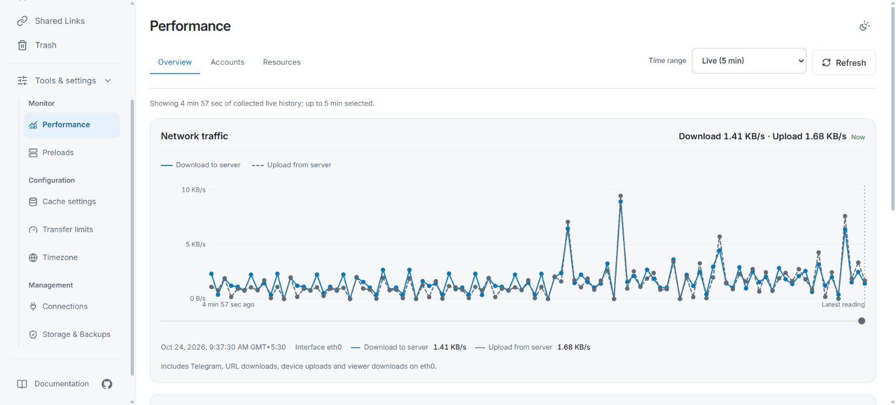

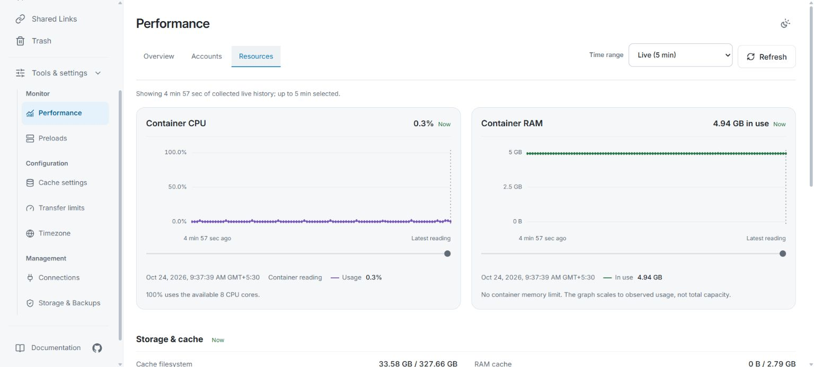

Values reflect this capture session and its deployment. They do not establish
speed or memory requirements for other devices or servers.

## Configure your drive

Open **Configuration** to inspect cache budgets, preloading, upload limits and
timezone. Use defaults first, change one category, and save that category to
apply it. The public visitor demo keeps these settings read-only.
[Settings, defaults and bounds →](configuration.md)

Cache, transfer and regional settings

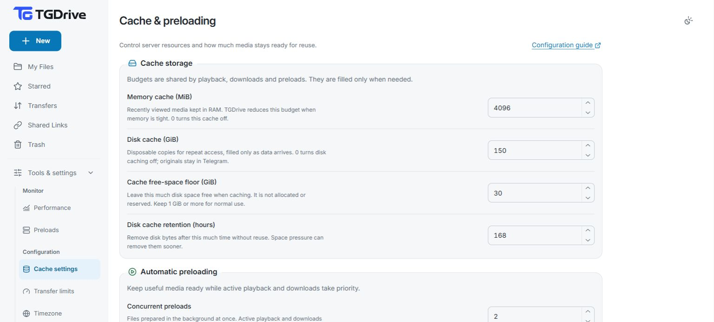

**Regenerate all thumbnails** rebuilds existing covers in the background after
confirmation. It can consume bandwidth; the screenshots show its entry point,
not a completed rebuild. [Thumbnail generation →](thumbnails.md)

**Transfer limits** includes uploads per bot, split size, temporary upload storage,
URL download concurrency and Telegram request budgets. Large files are split
automatically and still appear as one file. The screenshots do not demonstrate
a multi-gigabyte transfer or prove its recovery behavior.

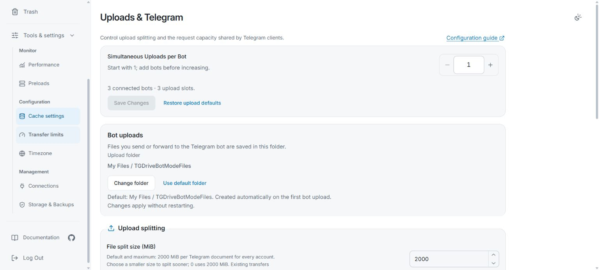

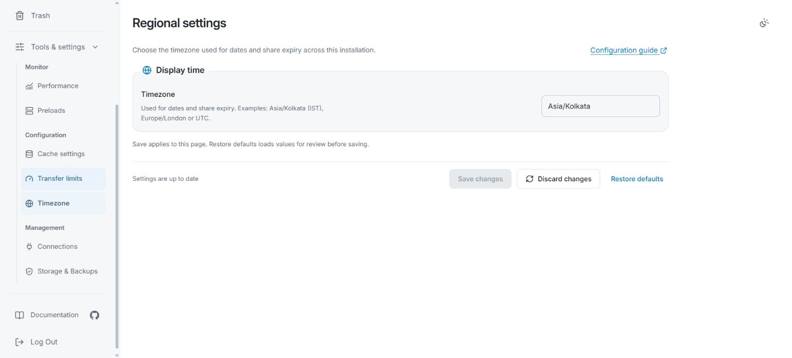

Appearance supports **Light**, **Dark** and **System** through its menu. Timezone
affects displayed times; stored timestamps remain UTC.

## Connections and backups

**Management → Connections** lists configured Telegram storage clients and
connection controls. Adding a bot, signing in a Premium account or replacing
credentials requires your own Telegram setup. These captures show website entry
points; they do not demonstrate a new Telegram authentication.
[Connections and credential changes →](usage.md#settings-and-connections)

Connections and Storage & Backups screens

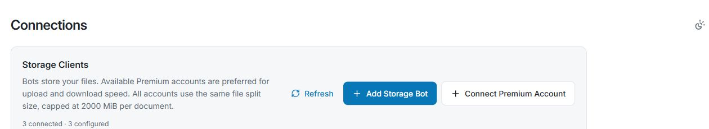

**Storage & Backups** distinguishes the saved catalog from temporary upload space.
Database backups protect the catalog; optional independent channel protection
copies completed documents too. A displayed screen is not proof of successful
backup or recovery. Follow the guide, confirm restore points and keep matching
keys outside the server. [Backup and recovery →](backup-recovery.md)

## Workflows beyond these recordings

| Feature | How to use it |
| --- | --- |
| Optional Telegram bot uploads | Configure the bot and administrator IDs, choose a destination in **Transfer limits → Bot uploads**, then send files privately to the bot. [Bot instructions](usage.md#optional-telegram-bot-interface) |
| Multiple devices | Log in using the same owner password. Sessions are independent; logging out closes only that session. [Device access](usage.md#use-several-devices) |
| Protected public samples | Browse **Demo Files**; create disposable uploads in **My Files**. Configuration and Management changes remain locked for visitors. [Demo guide](usage.md#try-the-public-demo) |
| Background processing | Once server receipt is accepted, uploads can finish without the tab. URL imports and manual preloads also continue while TGDrive runs. [When to close the tab](usage.md#can-i-close-the-tab) |
| Independent channel recovery | Prepare separate recovery access, wait for a confirmed restore point, then inspect and verify before activation. [Recovery procedures](backup-recovery.md) |
| Install, upgrade or move hosts | Preserve MongoDB, Telegram access, secrets and persistent data. [Setup](setup.md) · [Operations](operations.md) |

No bot messages, Premium sign-in, destructive recovery, full-drive cache clearing
or full-library thumbnail rebuild are performed for these demonstrations.
For capture provenance and replacement instructions, see the [media guide](assets/README.md).
