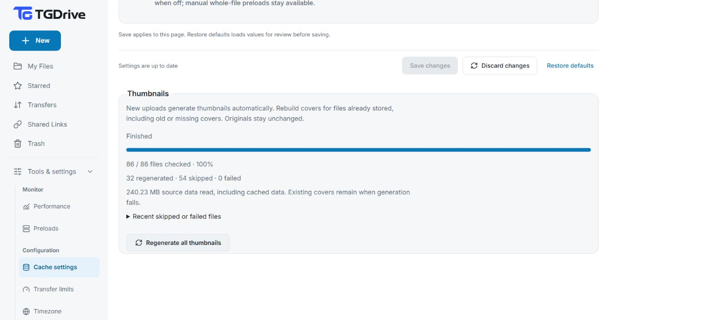

# Thumbnail generation

[Docs home](README.md) · [Browse files](usage.md#browse-and-organize)

TGDrive creates covers from files staged during upload. The original stays unchanged.

| File | Cover |
| --- | --- |
| JPEG, PNG, WebP, GIF, BMP, TIFF | Scaled image; one frame for animation. |
| MP4/M4V/MOV, MKV/WebM, AVI, WMV/ASF, MPEG | Random frame between 40% and 60% of the duration, with a first-frame fallback. |
| PDF | First page. |
| EPUB / CBZ / CBR | Declared EPUB raster cover (or first image); first naturally ordered comic page. |
| MP3, FLAC, M4A, Ogg/Opus, WAV, AAC | Embedded artwork when the container and decoder expose it; otherwise an icon. |
| DOCX/PPTX/XLSX, ODT/ODP/ODS | Embedded raster preview when the archive contains one. |
| AVIF | Image if the installed decoder supports it. |

## Bandwidth and storage

Grid view loads nearby thumbnails as needed, checking the local generated cover
then Telegram's small thumbnail. A missing cover can also be repaired from a
complete original already in the server cache. The grid never downloads original
payloads from Telegram to create a cover.
Data-saving browsers show icons. Every request checks current owner/share access,
including cache hits and conditional responses.

An optional missing cover returns **204 No Content**, keeping the format icon
without a false missing-file error. MP3s without provider artwork and images whose
decoding exceeds the worker budget retain icons. Giant TIFFs can exceed that
budget even when their compressed file is available.

## Rebuild existing thumbnails

In **Tools & settings → Cache settings**, choose **Regenerate all thumbnails**.
Review the warning about long runtimes and potentially substantial bandwidth,
then confirm **Start background rebuild**. New uploads generate covers
automatically; this action is for files already stored, including existing covers.

Find the thumbnail rebuild control

This capture shows the control; it is not evidence that a full-library rebuild ran.

The Settings page shows files checked, regenerated/skipped/failed counts, the
current filename, source bytes read and recent issues. It polls the server while
open. You can leave the page, close the browser or return later; **Cancel rebuild**
stops further work and keeps already generated covers. Source-byte counts include
cached data and are not a network-usage meter.

One run processes one file at a time and waits while transfers or media requests
are active. New reads use the lower-priority media queue and are paced to at most
2 MiB/s before cache/block overhead. A separate renderer at lower OS priority
keeps manual work out of the automatic upload-thumbnail slot. Existing requests
cannot be preempted, so shared CPU/disk/network work can still have a small cost.

Videos/images use a private loopback range bridge to FFmpeg; it requests selected
ranges through the shared cache rather than staging an entire movie. EPUB/comics
and supported office archives read their index and chosen cover. Most sources
have a **64 MiB cumulative read budget per file** and **four-minute file deadline**;
book operations also retain their **32 MiB** parser budget. PDFs need a local
seekable source, so rebuilding one may read the complete original up to **256 MiB**,
with a free-space check and crash-cleaned private staging. Larger or more
demanding files are skipped. Missing art,
unsupported decoders, encrypted/solid archives and giant images may retain icons.

Successful covers replace the disposable local cache and invalidate its previous
small-image response. Originals, catalog records and Telegram messages stay
unchanged; existing provider covers remain fallbacks. Cache limits below still
apply, so a large run can evict earlier local covers. Failed regeneration retains
any old cover. Files removed/changed during work are skipped; uploads arriving
after the scan use normal automatic generation.

Progress is saved locally between files and during reads when storage permits.
After a server restart, the last run is marked **interrupted**; start another rebuild
to continue refreshing covers. It does not silently restart a bandwidth-heavy job.
Demo visitors cannot start or cancel a rebuild.

## Existing files and fallback

New uploads attach the generated cover to the first Telegram part and cache it
locally. For an existing file with no provider cover, TGDrive can create a local
cover when its complete original is cached and no larger than **128 MiB**.
Choose **Preload file**, wait for full **Ready** coverage in **Preloads**, then
return to its folder in Grid view. Repair does not upload a new Telegram cover
or change the catalog; the disposable local JPEG can be reused afterward.

For automatic warm-cache repair, cold, partial, larger, unsupported, damaged,
encrypted or overly complex files keep provider covers/icons. Thumbnail failures never fail the original upload.
MOV is a container: its codec, resolution and decoding cost still need to fit
the installed decoder and rendering limits. A missing cover does not establish
that the original file is damaged or unplayable.

Cache limits, rendering and container dependencies

Generated JPEGs have a maximum 320-pixel edge and 64 KiB size. The disposable
`CACHE_DIR/thumbnails` cache holds at most 128 MiB/4,096 entries, evicts older
entries and avoids writes below 64 MiB free disk. It is separate from the media
budget and excluded from metadata backups; attached Telegram covers are the fallback.
Expired/deleted files remain inaccessible even if cached bytes survive.

Warm-cache repair runs one file at a time within an eight-second copy/render
deadline. It writes verified blocks to a private temporary file instead of joining
the source in RAM, checks complete coverage and multipart checksums, and requires
the source size plus the larger of 64 MiB or the configured cache free-space floor.
Owned temporary sources stay locked through decoding; startup and later repairs
remove unlocked crash leftovers without deleting active sources. Eviction, clearing,
revocation or cancellation aborts safely and removes the temporary source.
Negative thumbnail results are reconsidered when that file receives new cached
data; metadata probes and cache hits do not trigger repeated rendering of a
failed source. Temporary renderer/space/copy admission failures can retry without
new source data. Ordinary missing-provider results remain briefly cached.

Large JPEGs over 8 MiB use decoder downsampling before final scaling. EPUB/comic/office
covers reuse the bounded archive parser (32 MiB read budget, 16 MiB/image), never
extract archive paths or load remote resources, and pass recognized raster bytes through
a forced image decoder. Existing cached covers are not automatically replaced;
new uploads, explicit rebuilds and eligible warm-cache repairs use the updated
renderer.

Automatic rendering has one slot per process, a two-second admission wait and
12-second operation timeout. Manual rebuilding has its own single background
slot. Automatic video metadata probing is limited to 1.5 seconds. Extraction
first seeks to a random position between 40% and 60% of the duration, with a
six-second attempt timeout. If duration is unavailable, it seeks ten seconds
into the file instead. If that attempt fails, it tries the first frame with a
three-second timeout. This avoids most intros/credits but cannot guarantee a
nonblack frame; partial JPEG output is rejected. Busy admission or exhausted
rendering limits keep the provider-cover/icon fallback rather than delaying the
upload indefinitely. The Linux renderer has an eight-second CPU limit and a 768 MiB
virtual-address-space ceiling (including decoder reference frames, libraries and
thread stacks, not a reserved amount of RAM), with one decoding/filter thread
and a 64 MiB limit per allocation. These bounds accommodate tested UHD HEVC
MOVs but do not guarantee every codec/resolution or low-memory container;
forced demuxers and file/pipe-only local inputs block playlist/network loads.
The manual worker accepts only its token-protected loopback HTTP source and uses
a 120-second native deadline to accommodate paced range reads.

## Container dependencies

The TGDrive image includes FFmpeg and Poppler's `pdftoppm`; no host tool
installation is needed. Rendering failures fall back to provider covers/icons.
Keep the deployment image updated; resource bounds are not an OS security sandbox.

