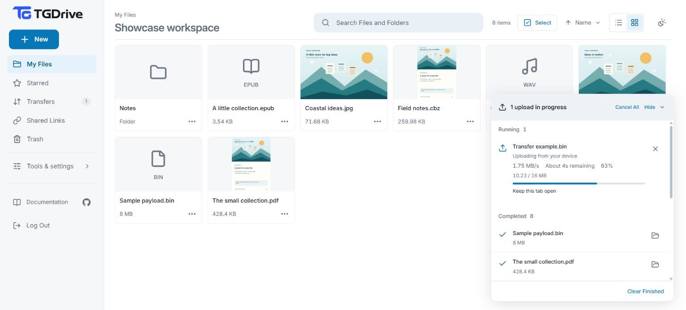
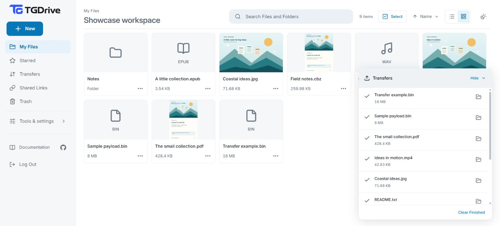

# Using TGDrive

[Docs home](README.md) · [Setup](setup.md) · [Help with problems](operations.md#troubleshooting)

**Must read before using TGDrive: [New-user guide and FAQs](new-user-guide.md).**
It covers essential limits, channel rules, privacy and backup responsibilities.

Upload in **My Files**, follow progress in **Transfers**, and share only what
you choose.

Prefer a visual introduction? [Open the gallery and walkthrough videos](showcase.md).

**Contents**

- [Use several devices](#use-several-devices)
- [Try the public demo](#try-the-public-demo)
- [Find your way around](#find-your-way-around)
- [Upload files or folders](#upload-files-or-folders)
  - [Upload speed and queue](#upload-speed-and-queue)
  - [Files above 2 GB](#files-above-2-gb)
  - [What upload progress means](#what-upload-progress-means)
  - [Can I close the tab?](#can-i-close-the-tab)
- [Transfer history](#transfer-history)
- [Browse and organize](#browse-and-organize)
  - [Starred files and folders](#starred-files-and-folders)
  - [Search](#search)
- [Open, preview, and download](#open-preview-and-download)
- [Create ZIPs and extract archives](#create-zips-and-extract-archives)
- [Preload a file for smoother playback and downloads](#preload-a-file-for-smoother-playback-and-downloads)
  - [Parallel and resumed downloads](#parallel-and-resumed-downloads)
- [Share and revoke](#share-and-revoke)
  - [Embed a file or folder in a website](#embed-a-file-or-folder-in-a-website)
- [Trash and permanent deletion](#trash-and-permanent-deletion)
- [Import from a URL](#import-from-a-url)
- [Import a torrent or magnet link](#import-a-torrent-or-magnet-link)
- [Settings and connections](#settings-and-connections)
  - [Storage and backup](#storage-and-backup)
  - [Upload through your Telegram bot](#optional-telegram-bot-interface)

## Use several devices

When your hosted server is reachable over the internet, open TGDrive in a browser
on your phone, tablet or computer to use the same drive on the go.

You can sign in on several devices or browsers with the same owner password and
use them at the same time. Each login has its own session; signing in again does
not disconnect other devices, and **Log Out** signs out only that session.
Tabs in the same browser profile share their session.

Multiple trusted people can also use the drive at once with the same owner
password. They share full access to its files and settings, with no separate
personal accounts or per-person permissions. Use read-only share links for people
who should only access selected files or folders.

## Try the public demo

**[Open the live demo](https://tgdrive.nexgenbots.us/)** · **Password:** `password12345`

Enter the public password on the sign-in page. No installation is needed.

**Demo Files** contains the operator's sample collection. You can browse, preview
and download it, but attempts to change the folder or its contents open a
read-only notice. Choose **Open My Files** in that notice to upload or organize
your own test files outside the protected folder.

Try browsing, uploading disposable sample files, organizing folders, previews,
downloads, sharing and preloads. **Configuration** and **Management** pages can
be viewed, but their settings and management actions are locked. Recovery keys
cannot be downloaded.

> [!IMPORTANT]
> Everyone shares the same files and changes. Other visitors can edit or delete
> files outside Demo Files. Use non-private, disposable content and keep your own copy.
> Do not rely on the demo to store files; automatic resets are not provided by demo mode.

Hosting a demo? See [Public demo mode](configuration.md#public-demo-mode).

## Find your way around

| Sidebar page | Use it to… |
| --- | --- |
| **My Files** | Browse, search and organize files |
| **Transfers** | See queued/running work and past completed, failed or cancelled transfers |
| **Shared Links** | Review or revoke links |
| **Starred** | Quickly find files and folders you marked |
| **Trash** | Restore files or delete them permanently |
| **Monitor → Performance** | Inspect current server resources, Telegram activity and measured traffic |
| **Monitor → Preloads** | Prepare files for faster access, see which parts are cached, stop preparation or clear cached copies |
| **Management → Connections** | Manage Telegram bots, Premium accounts and API credentials |
| **Management → Storage & Backups** | Check saved data, temporary storage and database backups |
| **Configuration → Cache settings** | Choose memory/disk cache limits, how long copies are kept and automatic preloading |
| **Configuration → Transfer limits** | Set upload concurrency, splitting and shared Telegram request budgets |
| **Configuration → Timezone** | Choose the installation's timezone |

Choose Light, Dark or System in the appearance menu. **Log Out** closes this
browser's access; server transfers continue. See [configuration](configuration.md)
for defaults and tuning.

**Refresh** and **Check Again** show progress and stay disabled until their
requests finish. A successful refresh shows a brief confirmation; failures show
an error so you can retry. Automatic background updates stay quiet.
If configuration refresh fails, open settings keep their unsaved drafts while
management controls stay disabled. Retry the refresh to continue editing.

## Upload files or folders

1. Open the destination folder in **My Files**.
2. Choose **New → Upload files** or **New → Upload folder**.
3. Select the files or folder. For a folder, confirm the short upload summary.
4. Follow the tasks in **Transfers**. Keep the tab open until **You can close this
   tab** appears; wait for **Completed** before deleting your originals.

You can also drag files into the file area. Each ordinary file or URL is its own
task, even when several files are selected together. Only a folder upload forms
an expandable group; select its name/chevron for individual states, or **Show
Folder** to reveal its directory. A folder stays **Running** while any file is active, then
**Queued** while work remains, then **Finished** (successful, failed or cancelled).

### Upload speed and queue

Device-to-server and server-to-Telegram uploads run independently.
Defaults are usually the best starting point.

<details>
<summary>Upload concurrency and large-file scheduling</summary>

#### Telegram upload capacity

**Configuration → Transfer limits → Parallel uploads** allows **1–4 per bot**,
default **1**. Changes apply immediately; lowering the limit lets running work
finish. Large-file parts use eligible slots, preferring available Premium
clients with bot fallback. All accounts share the same split cap.
More slots do not remove Telegram cooldowns or guarantee speed.
Splitting controls document size; pipelining overlaps requests within a document.
See [performance tradeoffs](performance.md).

#### Automatic device upload concurrency

Device uploads start with **two files**, adapting between **one and four** using
measured total throughput. Failures/stalls reduce new concurrency; running files
continue. Background pauses and server confirmation time are excluded.
Each file queues for Telegram once the server has verified and accepted its
bytes; it does not wait for the rest of the batch. If temporary upload storage
fills, remaining files wait/retry; smaller files may proceed when they fit. Keep
the tab open until **You can close this tab** appears. Small batches may finish
before adaptation.
New batches share device-upload slots fairly with existing batches, so adding a
folder does not wait for earlier Telegram work or an entire device batch.
See [measurement rules](architecture.md#adaptive-device-upload-concurrency).

</details>

### Files above 2 GB

**Splitting is automatic; Premium is optional.** Files appear as one item;
downloads reconstruct original bytes and seeking crosses part boundaries.
Database backups retain part mappings; independent backup copies the documents.

Default: **16 GiB per file**, subject to temporary upload space. Telegram documents use
at most **2000 MiB** for every account; **File split size** can lower that
(0 also means 2000 MiB). See [capacity limits](reference.md#file-capacity-staging-and-work-limits)
and [backup coverage](backup-recovery.md).

### What upload progress means

| Stage | What is happening |
| --- | --- |
| Uploading from your device | Your browser is sending bytes to the TGDrive machine |
| Queued | Waiting for an available upload slot |
| Uploading to Telegram | Sending file contents; they may not yet be posted as channel messages |
| Publishing to the channel | Finishing channel messages and saving the file record |
| Completed | The file and its record are confirmed |

The panel shows **device progress first** while any file from this browser still
needs to be received and accepted by the server. Files and folders already
accepted show **Received** without Telegram progress, speed or estimated time
remaining. Once all remaining files are accepted, the panel switches to Telegram
progress. Telegram work continues in the background throughout. Single-file
uploads omit redundant file-count summaries. Running/Queued counts include only
unfinished files; a folder's file count includes its completed files.

On desktop, choose **Hide** to keep a compact status panel while you browse. It
shows which uploads are running, queued, cancelling or need attention, with a
folder counted once in each applicable state. The second line tells you whether
to keep this tab open or open details to continue. After uploads complete or are
cancelled, it briefly shows **Uploads complete**, **Uploads cancelled** or
**Uploads finished** for mixed outcomes, then disappears after five seconds.
**Show** reopens the details.
On small screens, the status button opens **Transfers** and shows **Uploads need
attention** when only blocked uploads remain.

Time remaining estimates the bytes left in the displayed stage using recent
transfer speed. Folder measurements continue across individual file handoffs,
including small files that finish between updates. Estimates disappear when
progress goes stale, work is blocked or only server confirmation/publication
remains; those waits have no reliable byte-based duration.

**A full device bar alone is not a completed upload.** Keep the tab open during
server confirmation. **You can close this tab** confirms that the remaining work
can continue on the server; another batch still sending device bytes keeps the
close warning active. Resuming keeps the bytes the server has already confirmed.

<details>
<summary>See upload progress</summary>





[Watch the upload and sharing walkthrough](assets/upload-and-share.mp4).

**Uploading to Telegram** includes unfinished parallel parts. **Parts in Channel**
counts confirmed messages. My Files receives the item after every part is confirmed.
Batches count bytes for the displayed stage without adding device and Telegram
bytes together.

</details>

### Can I close the tab?

| Upload state | Can I close the tab? |
| --- | --- |
| **Still sending from your device** | Keep it open, or reselect the originals later to resume. Leaving early triggers a browser warning. |
| **You can close this tab** | Yes. Telegram uploading continues while TGDrive stays running. |
| **Completed** | Yes. This upload no longer needs the local source. |

To resume, use **Choose files / Choose folder / Choose file** in the existing
batch and select the same originals. TGDrive checks the received bytes, then sends
only what is still missing. The dismissible resume result stays with its upload
batch and reports how many files were added to the queue; it is not a live count
of files awaiting checks. When you choose the whole folder again, files already
in progress, received, completed or cancelled
are skipped without a mismatch warning. Files outside that upload or with a
different name or size still count as unmatched. Use the existing **Retry** action
after failure to avoid duplicates.

Only one tab in the same browser can send a saved device upload at a time.
Resuming it in another tab waits for the current sender, then checks the latest
server receipt. Device uploads require HTTPS (or localhost) and browser support
for Web Locks; an unsupported browser shows an error instead of starting an
uncoordinated upload. Server-owned jobs do not need that browser feature.
If TGDrive warns that recovery information cannot be saved, keep the original
tab open; another tab may not have its latest receipt or job identity.

Temporary connection and server errors retry automatically once TGDrive has
confirmed an upload session. Keep the tab open and the original files available
while it retries. If retries stop, read the file's error and use **Retry** (or
**Retry Failed** on a folder). An interrupted session-creation request still needs manual
retry because the browser may not have received its session identity.

Cancel waits for in-flight device requests and server cleanup before confirming;
it may also take time after Telegram work begins. **Cancel all** confirms the
currently selected unfinished work; completed files and later uploads are kept.
Desktop **Hide/Show** only collapses the panel; **Clear finished** only clears its list.

<details>
<summary>Folder upload limits and interrupted preparation</summary>

- The chosen folder becomes a new root. An existing name is kept alongside it;
  folders are not silently merged or overwritten.
- Relative subfolders and same-named files in different folders are preserved.
- The picker supports up to 1,000 files and 1,000 discovered folders, subject to
  path and request-size limits.
- Empty folders are not supplied by the browser's picker. Empty or oversized
  files are listed as skipped.
- Keep the confirmation open while TGDrive prepares the folder tree. Retry in
  that dialog reuses the preparation. Closing before files are queued can leave
  an empty tree; choosing again can create another root.
- Once files are queued, use the existing batch to resume. If copied files no
  longer match in bulk, choose them individually.
- Files uploaded into a shared folder inherit that folder's access.

[Protocol and exact bounds](reference.md#atomic-folder-preparation)

</details>

## Transfer history

**Transfers** keeps **Running** and **Queued** above finished history.
Filter finished work by **All / Successful / Failed / Cancelled**; search finds
names across history pages and current browser uploads. A search/filter change
returns to page 1. Each finished page holds up to **20 tasks**: a folder counts
once, and each ordinary file or URL counts separately. Use the page numbers or
arrow buttons to navigate. A folder's files stay together; matching its name or
any child's name keeps that whole folder in the search results.

If saved server history cannot load, this browser's recovery rows remain
available alongside the error. You can still choose originals, retry or cancel;
the upload endpoints must be reachable for those actions to finish.

Double-click a completed file or choose **Show in folder** to highlight it;
folder batches have **Show folder**. Moves/renames are followed. Trashed or
deleted items become unavailable; unfinished/failed rows do not navigate.

Choose **Clear history** beside the finished filters, then confirm to remove
successful, failed and cancelled entries across all pages, regardless of the
current filter or search. This also removes entries for deleted files and cannot
be undone. Stored files, queued/running uploads and transfers waiting for an
original file are kept, including failed device uploads that still have a
resumable receipt. Folders with unfinished uploads keep their member rows;
clear again after they finish. Saved server history is cleared for all devices;
browser-only history is cleared in the browser you use.

On phones, the bottom upload status opens Transfers. The desktop floating panel
shows this browser's work; Transfers also shows other devices' server jobs.
Clearing the panel does not erase saved history. Finished history survives
restart until manually cleared; previously expired records cannot be recreated.
Start uploads in a destination in **My Files** using **New**.

<details>
<summary>History storage and limits</summary>

Folder uploads save their explicit selection and grouping on the server for
other devices and reloads. Individually selected files remain separate, including
files with similar names or paths. Compact MongoDB summaries are included
in encrypted backups, omit payloads/source URLs/private recovery context, and
consume database space. Device-only work remains browser-scoped and needs originals.

</details>

## Browse and organize

| Action | How |
| --- | --- |
| Select | Choose Select to turn on selection mode; icons remain visible beside checkboxes |
| Open a file or folder with a mouse | Double-click, use Enter on its focused name, or choose Open |
| Open on a touch screen | Tap once |
| Select several items | Choose Select, then tap rows or check their boxes |
| Clear selection | Done or Escape |
| Create a folder | New → New folder |
| Rename, move or trash | Open the item's menu, or use the selection actions |
| Sort | Choose Name, Date Added or File Size, then Ascending or Descending |
| Change view | Choose List view or Grid view |

Folders stay first when sorting; click an active column to reverse order.
The browser remembers list/grid view. Phones combine these controls in
**View and sort**; Select/Done remains available.

New supported uploads generate small covers without changing originals.
Grid view fetches nearby thumbnails, not whole files; data-saving browsers use
icons. An existing missing cover can be repaired after preloading the full original
(up to 128 MiB), then returning to its folder in Grid view. See [thumbnail formats
and limits](thumbnails.md). To refresh existing covers, use **Configuration →
Cache settings → Regenerate all thumbnails**, review the bandwidth warning, and
follow its background progress there. Name conflicts offer **keep both**
or **skip**, without silent replacement.

### Starred files and folders

Use **Add to Starred / Remove from Starred** in an item's menu. Stars are owner
bookmarks included in backups; removing one keeps the file. They follow moves/
renames, hide while trashed and return on restore. They do not grant shared access.

### Search

Search finds names within the current page, not document contents:

| Page | What search finds |
| --- | --- |
| **My Files** | File and folder names across your drive, with their locations |
| **Transfers** | Current upload names and saved transfer names across all history pages |
| **Trash** | Names of the trashed items available to restore or delete |
| **Starred** | Names in your starred files and folders |
| **Shared Links** | Names in your shared-link inventory |
| **Preloads** | Cached filenames and preparation jobs |

**Enter** searches immediately; **Escape** clears and returns My Files to the
previous folder. Switching pages clears the query. **/** or **Ctrl/Cmd+K** focuses
search outside an editing field. On phones, the search icon opens it; Close
Search/Escape collapses an empty field.

<a id="create-and-extract-zip-archives"></a>

## Create ZIPs and extract archives

To download several items together, choose **Select**, select the files or
folders, then choose **Create ZIP**. Enter a ZIP filename and start the job.
TGDrive saves the ZIP as a normal file in the destination shown in the dialog;
download it from its item menu when the job finishes. A folder's item menu also
offers **Create ZIP**. Folder structure and empty folders are preserved, and
originals stay in place.

To unpack a supported upload, open its item menu and choose **Extract archive**. Choose
the current folder or a new folder, enter the new folder's name when needed,
then start extraction. Existing names are kept: outputs use available names
instead of replacing existing items. The original archive is kept.

| Extract | Filename extensions |
| --- | --- |
| ZIP, 7-Zip and RAR | `.zip`, `.7z`, `.rar` |
| TAR | `.tar` |
| Compressed TAR | `.tar.gz` / `.tgz`, `.tar.bz2` / `.tbz` / `.tbz2`, `.tar.xz` / `.txz`, `.tar.zst` / `.tzst` |
| A single compressed file | `.gz`, `.bz2`, `.xz`, `.zst` |

For example, `backup.tar.gz` extracts its folder tree, while `notes.txt.gz`
produces one `notes.txt` file. Single compressed files use the uploaded name
without the final compression suffix. ZIP creation remains uncompressed for low
CPU use. The Docker image includes the native archive reader; other installations
need libarchive installed, as for CBR reading.

Follow progress, retry failures or cancel in **Transfers**. Once accepted, archive
work can continue with the tab closed while TGDrive, MongoDB and Telegram remain
available. Archive creation downloads source bytes to the server and uploads the
result to Telegram; extraction also uploads its output files. Both need temporary
server disk space and consume Telegram bandwidth. A ZIP stored inside a publicly
shared folder, or files extracted there, inherits that folder's public access;
review the warning before continuing.

Encrypted and split/multi-volume archives, unsafe paths, links, duplicate
paths and archives containing empty regular files are rejected. TGDrive cannot upload
zero-byte files to Telegram. Empty folders are supported. Cancellation or failure
can leave files and folders already created; retry the existing job to continue
rather than starting another extraction. Preserve the server's cache directory
across restarts. If temporary archive data has been removed, the error may ask
you to cancel and start again; earlier committed outputs remain. See the
[archive API and exact limits](reference.md#archive-jobs). Some RAR features and
archives requiring very large decompression dictionaries are unsupported; the
job reports an error and keeps the source intact.

## Open, preview, and download

Double-click with a mouse or tap on touch to preview. **Download** gets the
original; **Escape** or browser **Back** closes the preview. Use the header's
fullscreen control where supported. Non-video previews enter fullscreen with
the toolbar visible; use the top-right icon to hide or show it. Video keeps its
own player controls. Download the original if the device cannot decode it.

Opening a video loads its metadata and decodes its opening frame while paused.
Fetching and decoding can take time; a video that begins with black frames can
still look black.

Video playback uses available bandwidth to build about **90 seconds of buffer**,
within a browser memory limit. Short clips can load completely. The player refills
early so brief network dips and forward skips can use already fetched bytes;
very high bitrate video may reach the memory limit sooner. See the
[playback buffer policy](performance.md#browser-playback-buffer).

Closing the preview releases its browser buffer. Reopening requests the file
again; authorized requests reuse the server's cached chunks while available.
Protected originals use `no-store`, so browser disk caching is not promised.

Reopen a video preview and choose **Continue from…** to resume its saved position.
Positions use **h:mm:ss** from one hour onward, for example **1:17:15**.
Opening alone does not start playback; the usual **Play** button starts from the
beginning. Progress is saved on this site's browser profile, so different devices
and browsers can watch independently even with the same TGDrive login. People
sharing one browser profile share its saved positions. Finishing a video clears
its position.

Saved positions survive closing the preview and reloading, but clearing this
site's browser data removes them; private browsing may discard them when closed.
If local storage is unavailable or full, playback still works but progress may
not be saved. An abrupt browser/device shutdown can lose the most recent seconds.
This applies to the enhanced preview player; standalone stream links use the
browser's native player.

When a non-video preview waits, it can show **Checking file**, **Waiting for
Telegram capacity**, or **Receiving file**. Any wait estimate is approximate;
the underlying queue counts Telegram operations, not people. Image and audio
previews automatically retry a full Telegram queue at most twice, respecting the
server's retry delay. Keep the preview open for those retries; after they are
exhausted, use **Try Preview Again**. Other failures still need manual retry.
Video uses its own playback/buffer status. Downloads use the browser's download
controls, require a connected browser, and have no saved queue position after a
server restart. See [shared-download limits](performance.md#shared-download-load-and-queues).

| File | Preview |
| --- | --- |
| Images, including SVG | Image viewer |
| PDFs up to 256 MiB | Continuous scrolling, zoom, Fit width and Fit page |
| Video | Enhanced player with its own audio/subtitle controls |
| Audio | Browser audio player |
| Supported text and code | Read-only text; first 256 KiB |
| EPUB | Chapter reader, text size and saved reading position |
| CBZ and CBR | Comic pages, page fit and right-to-left navigation |
| Other unsupported formats | Original download |

PDFs, EPUB and comics request needed sections without automatically preloading
the whole file. See
[book/comic controls and practical limits](reading.md).

<details>
<summary>Video, PDF and keyboard controls</summary>

| Control | Action |
| --- | --- |
| Video **K/Space**, **M**, arrows | Play/pause, mute, seek when focused |
| Double-tap picture left/right | Seek 10 seconds; further taps add 10 seconds |
| Single touch | Show/hide controls; outside an open menu, dismiss it |
| Settings **Up/Down**, **Home/End**, **Enter/Space** | Navigate and select |
| Settings **Escape** | Return from subpage, then close menu before preview |
| **Chapters** | Movi's native chapter strip and seek-bar segments; also available in fullscreen |
| **Settings → Quality** | Telegram alternatives, when available; preserves position/play state |
| **Try again** after a long wait | Retry video preserving position/play state |
| PDF **Fit width / Fit page** | Reading width / whole page; manual zoom leaves fit mode |

Phones put chapters/picture in picture in Settings when available. Audio/subtitle
choices depend on the file. **Ambient mode** uses the picture's colors;
**Stable volume** softens volume changes; **Aspect** controls picture fit.
Controls hide when idle but remain visible for keyboard focus.

Use the native subtitle menu's **Add subtitle…** action for a local subtitle file;
it stays in the browser. Hover over the seek bar for a keyframe preview. Chapters
show embedded titles/times immediately and load images for visible cards as you
scroll. Repeated positions reuse the player's frame cache; uncached positions
may need additional video ranges. Chapter image work pauses while playback is
loading, buffering or seeking, and while the tab is hidden. The native player supplies track selection,
speed, loop, HDR and picture controls when the file/browser supports them.

The video timeline estimates the device's loaded ranges, separate from server
cache coverage. Longer waits show **Waiting for video… / Loading this part…**.
The animated status shows actual received bytes and current speed when available;
these include seek/repeat reads, not a file-completion percentage. A compact status
strip stays above the controls; longer waits add an inline retry action. Playback
can start before the whole file is loaded.

When the picture stalls during playback, sound and the playback clock wait while
the player refills, then resume automatically. Background audio and a soundtrack
that continues after the video ends are allowed to keep playing.

Video previews use Movi's browser-side player. **Software decoding on this
device** means playback can be
limited by the device even when download speed is fast; use **Download Original**
to open a difficult file in a video app.
Browsers may require a tap for sound; codec/fullscreen support varies by device.
Image alternatives use **Preview quality**. Web uploads preserve original bytes;
Telegram may not create lower-quality versions.

</details>

## Preload a file for smoother playback and downloads

**Preload file** caches the **whole original on the server** before a movie,
large download or busy share. It uses server storage/bandwidth; your device
receives bytes when you play or download.

1. Choose **My Files → file ⋯ → Preload file** and start.
2. Follow **Monitor → Preloads**. **Ready** with full coverage means the whole
   file is cached; blue segments mean partial coverage.
3. Play, download or share normally. Recheck coverage before relying on it.

Preloading continues with the tab closed while TGDrive runs; foreground playback/
downloads take priority. **Cancel** keeps cached bytes; clearing cache keeps
Telegram originals. Cached bytes can expire or be evicted after completion.
Preloading is not a backup and does not keep a sleeping server online.

<details>
<summary>Automatic read-ahead, download managers and cache limits</summary>

### What happens when I just open or stream a file?

Preloading is optional. Requested sections are cached with bounded adaptive
read-ahead. **Preload during playback** (default On) also warms upcoming original
audio/video after sustained delivery, adjusting for bitrate and seeks.
A first viewer does not trigger a whole-file preload; separate viewers may
justify one within cache policy. One player's overlapping requests do not count
as extra viewers. PDFs/books/comics stay sparse; lower-quality previews do not
automatically preload the original. Manual preloading always targets the original.

### Parallel and resumed downloads

Use file **⋯ → Copy Download Link**, then paste into your download manager.
This is a [read-only share link](#share-and-revoke), separate from your owner login.
Managers can request ranges in parallel or resume; the manager must retain its
own received-byte state. Downloads read ahead only within requested ranges,
without warming unrelated gaps/the whole file. Shared cold blocks reuse origin
fetches; Telegram alignment can fetch extra origin bytes while the response
contains only the requested bytes. See [delivery policy](performance.md).

### Storage, progress and limits

The whole file must fit either the available memory cache or the disk cache,
including overhead and other preparation jobs' reserved space. The two cache
limits are not added together.
If rejected, free space, raise **Configuration → Cache settings** or wait for
other jobs. Larger files can still stream in chunks.
Preloads sorts by newest downloaded data, not cache reads or page refreshes.
Cache access needs a valid session/share. Cold seeks, Telegram/network delays and
decoding can still buffer. See [cache limits](performance.md).

</details>

## Share and revoke

1. Use the item's share action; optionally add a label.
2. Choose one day, seven days, 30 days, no expiry or a custom date/time.
3. Copy the link, or copy it later from **Shared Links**.

> [!IMPORTANT]
> Anyone with the link can read its contents, including a folder's accessible
> descendants. Labels organize links; they do not restrict them to named people.

Each item supports up to **100 independent links** with separate labels/expiries.
Create additional links through the item's share action in **My Files**.
**Shared Links** keeps one row per link, showing its purpose when labelled,
location, creation time and expiry so links for the same item stay distinguishable.

| Action | What it does |
| --- | --- |
| **Active / Expired / All** | Filter links by whether they still grant access. |
| Copy icon | Copy this exact active link again; no replacement or extra link is created. |
| **Copy embed link** | Copy this link's file viewer or folder browser for an iframe. |
| **Edit link** | Change this link's label or expiry, including a custom date or no expiry. |
| Click the name or **Show in folder** | Open its current directory and highlight the item. |
| **Revoke link** | Confirm before blocking this link. Other links keep working. |

Hover/focus/tap expiry for its exact time/timezone. Expired or unavailable links
have a disabled copy icon with an explanation. If TGDrive cannot reconstruct
a URL, such as after changing `SESSION_SECRET`, use its original copy; existing URLs
keep working until expiry or revocation. Create any replacement through
**My Files** and revoke the old link separately when appropriate.

Explicit links survive moves/renames. Moving/restoring into a shared folder asks
for confirmation; moving out removes inherited access but keeps explicit links.
Trash revokes subtree links. Revocation stops future authorized stream blocks,
not already downloaded copies. Invalid tokens fail even in an owner's browser.

For download tools, use **Copy download link**, not an owner address that needs
browser cookies. It creates or reuses a separate share labelled **Download link**;
new links last **one day** and can be revoked in Shared Links. Keep the URL secret.

### Embed a file or folder in a website

1. Create a share link from the file or folder's share action.
2. Use **Copy Embed Link** in that popup, or **Copy embed link** on its row in
   **Shared Links**. If clipboard access fails, select and copy the displayed URL.
3. Paste the embed URL into your website's iframe `src`. For example, replace
   the example URL below with your copied link (write `&` as `&amp;` in HTML).

```html
<iframe
  src="https://drive.example.com/embed?path=%2Fshare_FOLDER_ID&amp;auth=TOKEN"
  title="Shared project files"
  width="100%"
  height="600"
  allow="fullscreen; picture-in-picture"
  allowfullscreen
  loading="lazy"
  referrerpolicy="no-referrer"
></iframe>
```

A file embed opens TGDrive's viewer; unsupported formats offer a download.
A folder embed lets visitors browse its accessible subfolders, preview files
and download originals. Visitors do not need the owner password. TGDrive must
stay running and reachable; the page containing the iframe controls its size.

The embed and ordinary share link use **the same access, expiry and revocation**.
Copying an embed link creates no additional share. Folder access includes current
and future accessible descendants. Anyone who can view the containing page can
obtain the link and read those contents; use public pages only for content you
intend their visitors to access. Revoking the link also blocks the embed's future
requests, but cannot recall delivered or downloaded data.

If a frame is blocked, your website must permit TGDrive in its frame policy,
and TGDrive's reverse proxy must allow framing **`/embed` only**. Keep frame
protection on owner pages. See [the browser policy](reference.md#security-and-privacy).

## Trash and permanent deletion

Each item shows **Deleted from: My Files / …** so you can identify its source
folder before restoring or deleting it.

- **Move to Trash:** hides the item while keeping its Telegram files.
- **Restore:** brings it back, subject to name and access checks.
- **Delete permanently:** removes the selected file/folder records, descendant
  records and their shares from TGDrive's database after you confirm. Original
  Telegram messages remain in the storage channel. It cannot be cancelled or
  restored from Trash after completion.

Accepted items disappear from Trash while deletion continues on the server,
including after closing the tab or restarting TGDrive. Failed items reappear;
use **Retry Failed deletions** in the Trash notice to try again.

### Why permanent deletion keeps the Telegram files

> [!WARNING]
> **Original Telegram files remain after permanent deletion.** Removing an item
> from TGDrive does not securely erase its contents from Telegram.

Channel members may still read those messages; older backups may restore records.
Recipient copies and caches also remain. Erasing Telegram originals separately
requires an authorized account.

<details>
<summary>Deletion progress and retries</summary>

The combined notice on **Trash** reports background progress and failures.
Connection/list-refresh failures retry automatically. Backup protection checks or
upload cleanup may delay completion; hiding an item does not confirm removal.
Running/failure details stay on Trash; successful notices dismiss after six
seconds (paused on hover/focus) and do not return after navigation/reload.

Retrying an older failed deletion job also removes only database records; it
cannot restore Telegram messages that were previously erased. Independent backup
protection still applies; see [backup and recovery](backup-recovery.md).

</details>

## Import from a URL

Choose **New → Upload from URL** and enter a public HTTP(S) file URL.
The dialog closes immediately and Transfers shows an animated **Checking source…**
state while the server connects and checks the response. Source failures appear on
that transfer with a retry action. You can keep browsing or cancel during checks;
a percentage appears only when file bytes start arriving.

TGDrive downloads to the server, then sends to Telegram. By default two imports
receive at full speed. Others show **Queued · receiving slowly** when a slow source
connection is available, **Waiting for a source connection** at the connection cap,
or **Waiting for temporary storage** when temporary upload storage is full. Slow reception can help
avoid idle timeouts, but cannot extend a link's fixed expiry. Change full-speed
concurrency (1–8) in **Configuration → Transfer limits → URL downloads**.

**Downloading from URL** measures source intake; the later Telegram upload has its
own speed and progress. Parallel retrieval adapts automatically where supported.
Use **Compatibility Mode** for sources that reject it. See
[URL import performance](performance.md#url-import-intake) for bounds and fallbacks.

After submission it continues with the tab closed while TGDrive runs.
Temporary source interruptions retry automatically and show a countdown and
attempt number. **Retry** is needed after the bounded retry budget is exhausted
or after correcting a permanent error; intake restarts from the beginning.
Private network URLs are blocked by default. URL jobs never need a device file;
if the server job is gone, submit a new URL import.

## Import a torrent or magnet link

Choose **New → Import torrent** in the destination folder and paste a magnet link
or a public HTTP(S) URL to a `.torrent` file. TGDrive imports every file and keeps
nested folders. A single-file torrent becomes a file in the selected folder;
a folder torrent creates its own folder there.

Transfers shows metadata discovery, torrent downloading and then Telegram
uploading. Percentages describe the current stage. After submission you can close
the tab while TGDrive keeps running. Downloads depend on available peers; a link
with no reachable seeds may fail even when the link is valid.

Use **Retry** on a failed transfer, or **Cancel** to stop unfinished work.
Files already saved to your drive remain. Torrent imports need temporary server
space for the whole torrent before Telegram uploading starts. See
[torrent import limits and recovery](reference.md#torrent-imports) for supported
sources and restart behavior.

The torrent network sees the TGDrive server's IP address. Downloaded pieces may
be shared with peers while downloading; TGDrive stops seeding when the download
finishes. Import only content you are entitled to use.

## Settings and connections

Use **Management → Connections** for accounts/API credentials and
[Configuration](configuration.md) for cache, transfer limits and timezone.

| Action | Result |
| --- | --- |
| **Refresh** | Checks every enabled client's saved credentials and channel permissions; updates names |
| **Manage** | Rename the local label, replace a credential, enable, disable or remove a client |
| **Add storage bot** | Connect another administrator bot in the same channel |
| **Connect Premium account** | Sign in with a phone number, Telegram code and optional two-step password |

For an additional storage bot, create it in BotFather and give it administrator
access to the same private channel with **Post Messages** and **Delete Messages**,
then choose **Add storage bot**. Manage storage accounts here rather than adding
tokens to your deployment configuration.

Refresh runs in the background, skips disabled accounts and retries temporary
failures with Telegram waits. Its confirmation means the checks were requested;
watch each connection's result for verification. Keep at least one working
storage bot.
Revoked/lost-access connections are excluded and show a repair action;
see [connection recovery](operations.md#revoked-tokens-removed-sessions-and-lost-channel-access).

Finish/cancel pending transfers before changing accounts, enabled states or API
credentials. Replacing credentials for the **same Telegram account** can repair
pending work; keep other settings unchanged. Saved changes pause new uploads
until you [restart TGDrive](operations.md#run-and-monitor).

Blank replacement fields keep current secrets; secrets are never displayed back.
The web password/storage channel are installation settings.

### Storage and backup

**Management → Storage & Backups → Saved to MongoDB** confirms the saved catalog,
not completion of unfinished uploads.

- **Temporary storage** is server disk reserved for unfinished uploads, not a Telegram storage limit.
- **Back up now** makes a complete encrypted database copy in your private channel.
  Automatic copies normally run hourly.
- **Save recovery key** downloads the key needed to restore those copies.
  Store it separately.

Reconnect the same MongoDB after losing the local installation. For database
loss, follow [backup and recovery](backup-recovery.md).

<details>
<summary>Upload through your Telegram bot</summary>

<a name="optional-telegram-bot-interface"></a>

The standard new-drive setup configures `MAIN_BOT_TOKEN` and
`TELEGRAM_ADMIN_IDS`. Open that bot in a **private chat**; only the listed Telegram
users can use it. Existing installations using only `BOT_TOKENS` can keep working
without this interface, or enable it by adding a main bot token and allowed user
IDs to their deployment configuration and restarting TGDrive.

1. Open **Configuration → Transfer limits → Bot uploads** on the website.
2. Click **Change folder**, browse to a destination, then click **Use this folder**.
   To restore the default, click **Use default folder**.
3. Send or forward files, photos, videos or audio to the bot. It shows **Saving…**,
   then confirms the filename and destination. Send photos as files to preserve
   their original quality.

Default: **My Files / TGDriveBotModeFiles**, created on first use. The shared
destination setting applies to every administrator's next file without restart.
Existing imports keep their destination; moving/deleting it pauses new imports
until an available folder is chosen.

Sending or forwarding the same file again saves another copy. TGDrive does not
compare file contents; name conflicts keep both, for example `report.pdf`,
`report (1).pdf`, then `report (2).pdf`.

If the bot says **Upload could not be confirmed**, check the drive before
resending. TGDrive keeps the Telegram copy when the catalog write outcome is
uncertain; the file may already be saved.

**/start**, **/help** explain uploads; **/current_folder** shows the destination;
**/set_folder** links to its website setting (normal owner login, no token).
The website address is remembered on save; optional `PUBLIC_URL` supplies it
beforehand or when local access differs from the public domain.
Bot imports lack the web queue's durability; see
[known limits](roadmap.md#known-correctness-and-recovery-gaps).

</details>
